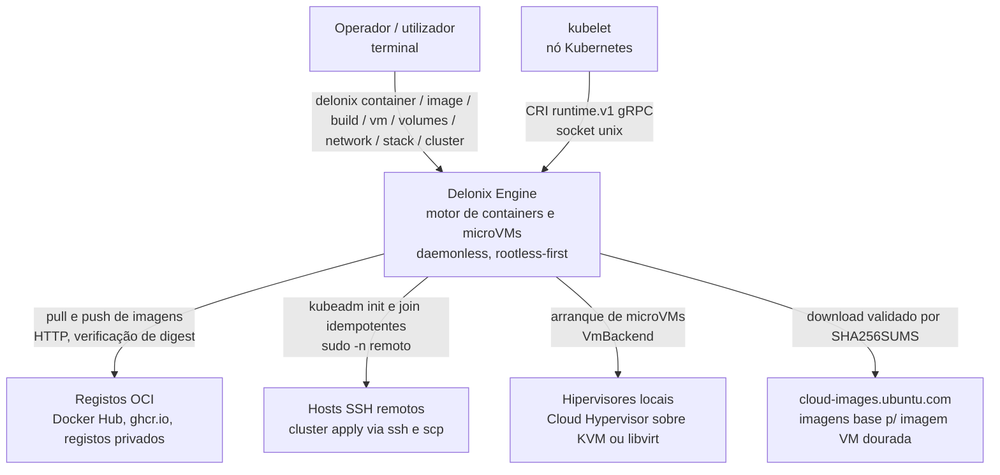
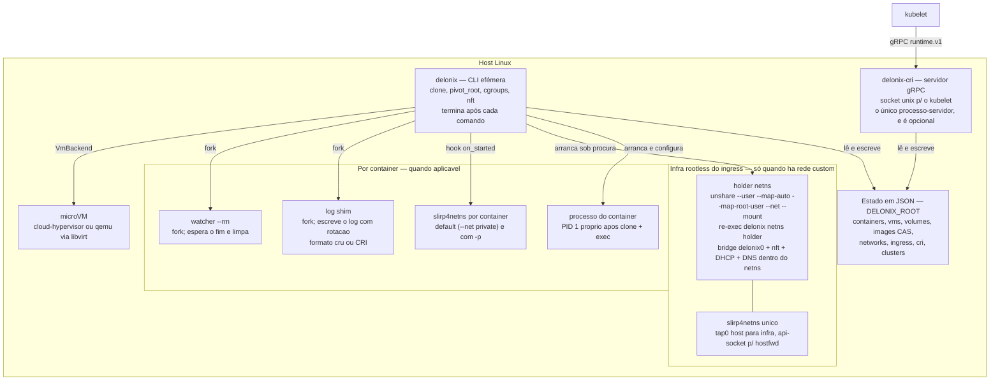
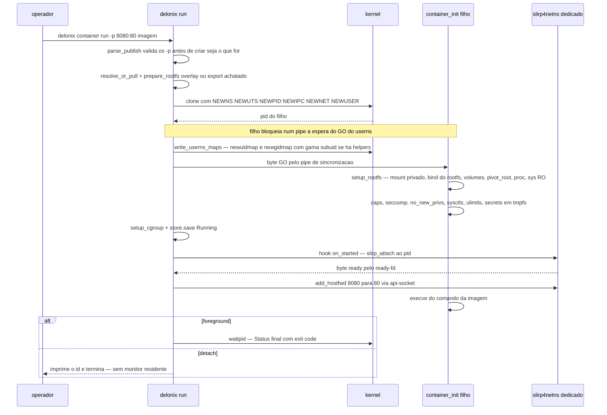
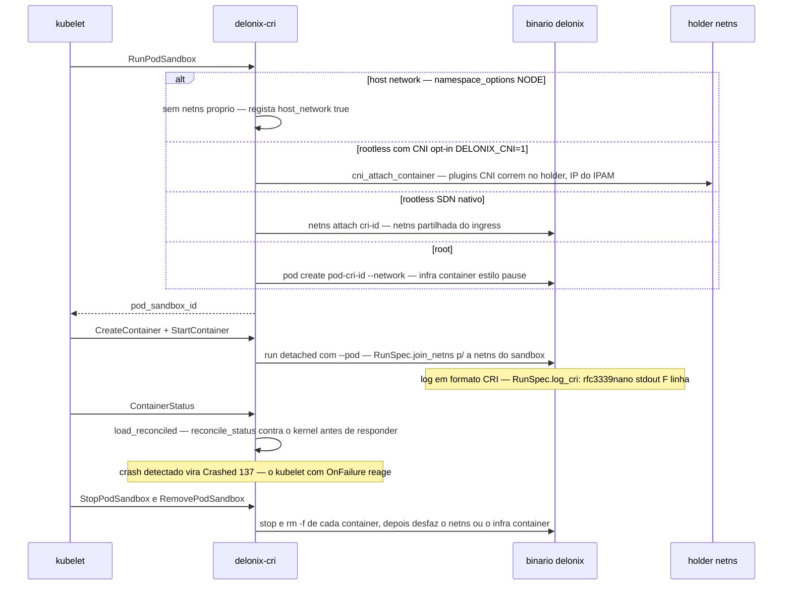

# Architecture — Delonix Engine

C4 model (Context → Containers → Components) and functional system design of the
**Delonix Engine**: a **daemonless, rootless-first, kernel-native** container and
microVM engine, written in Rust (41 crates, `crates/` workspace). This document is
canonical and kept in sync with the code — every structural claim carries a reference
to the crate/file where it was confirmed. Where limits exist, they appear in the
diagrams, not hidden away in footnotes.

Naming convention: `delonix` is the CLI binary (crate `delonix-bin`);
`delonix-cri` is the CRI server binary (crate `delonix-cri`); "holder" is the process
that holds the infrastructure network namespace of the rootless ingress
(`crates/adapters/delonix-sdn/src/infra.rs`).

---

## C4 — Level 1: Context

The Delonix Engine is used by a **human operator** (via the CLI), by a **kubelet**
(via CRI), and talks to external systems: OCI registries, remote SSH hosts and the
local hypervisors.



- CLI: `bins/delonix/src/main.rs` (groups `Container`/`Image`/`Build`/
  `Vm`/`Volumes`/`Network`/`Stack`/`Cluster`, one module per group under `src/cmd/`).
- CRI: `crates/interfaces/delonix-cri/src/bin/delonix-cri.rs` → `serve_blocking` on a unix
  socket (`DELONIX_CRI_ADDR`, default `unix:///run/delonix-cri.sock`), the endpoint of
  the kubelet's `--container-runtime-endpoint`.
- OCI registries: `crates/adapters/delonix-oci/src/registry.rs` (`pull_from_registry_with_creds`,
  `push_to_registry`, `push_oci_artifact`/`pull_oci_artifact` — this pair with
  verification of the blob digest against the manifest).
- SSH hosts: `bins/delonix/src/cmd/remote.rs` (shell-out to the system's `ssh`/`scp`,
  remote `sudo -n`).
- Hypervisors: `crates/adapters/delonix-vm/src/lib.rs` (trait `VmBackend`, implementations
  `CloudHypervisorBackend` and `LibvirtBackend`).
- Public boundary: this repository knows nothing about tenant, licence, billing or
  console — any consumer of that kind is "external" (see ADR-7).

---

## C4 — Level 2: Containers (executable units)

**There is no daemon.** No mandatory resident process exists: the CLI is ephemeral,
and the long-running processes that do exist are *opt-in* infrastructure (rootless
networking, log shim, `--rm` watcher, VMs) — each starts when it is needed and dies
with the resource it serves. Shared state is a directory of JSON files, not a daemon
socket.



Confirmation in the code, piece by piece:

| Process | Where it is born | Lifetime |
|---|---|---|
| `delonix` (CLI) | `bins/delonix/src/main.rs` | one command; in foreground it `waitpid`s the container and exits |
| `delonix-cri` | `crates/interfaces/delonix-cri/src/bin/delonix-cri.rs` | service (e.g. the systemd unit `dist/delonix-cri.service` inside the golden VM image) |
| holder netns | `infra::start_holder` (`crates/adapters/delonix-sdn/src/infra.rs`): `unshare --user --map-auto --map-root-user --net --mount -- <self> netns holder`; the re-exec is caught in `main.rs` before the clap parser | lifetime of the ingress infrastructure, managed by a file-based ref-count (`infra::acquire`/`release`) |
| single slirp4netns | `infra::start_slirp` — connects `tap0` to the holder's netns, with an api-socket for `add_hostfwd` | follows the holder |
| per-container slirp4netns | `delonix_sdn::slirp_attach` (`crates/adapters/delonix-sdn/src/lib.rs`) — called as the `on_started` hook of the `RunSpec` | lifetime of the container (dies with the netns); orphans cleaned up by `reap_orphan_slirp` |
| log shim | `fork` in the parent at `spawn` (`crates/adapters/delonix-linux/src/lib.rs`), runs `log_shim` — reads the pipe (or the pty master in console mode) and writes the log with rotation | lifetime of the container; detaches from stdio with `setsid` + `/dev/null` |
| `--rm` watcher | `spawn_rm_watcher` (`bins/delonix/src/cmd/container.rs`) — only on `run -d --rm` | until the container exits; performs the same cleanup as `rm -f` |
| microVM | `delonix_vm::create` — a `cloud-hypervisor` process (inside the infra netns, tap via `infra::vm_attach`) or a libvirt domain | lifetime of the VM |

State lives in `$DELONIX_ROOT` (default `/var/lib/delonix` for root,
`~/.local/share/delonix` for rootless — `infra::base_root` and
`ImageStore::default_root`): `Store`/`JsonStore`
(`crates/adapters/delonix-state/src/store.rs`) persist `Container`/`Vm` as one JSON
file per record; the CRI keeps its own records under `<root>/cri/`
(`crates/interfaces/delonix-cri/src/runtime_svc/lifecycle.rs`).

A direct consequence of being daemonless: since there is no resident monitor, the
`Running` state of a JSON record can diverge from the kernel. The truth is reconciled
at read time — `reconcile_status` (`crates/adapters/delonix-linux/src/lib.rs`) uses
`safe_to_signal` (PID + `starttime` from `/proc`, to close the PID-reuse window) and
reclassifies `Running`→`Crashed`/`Paused`. The CRI calls it in `load_reconciled`
before replying to the kubelet.

---

## C4 — Level 3: Components (the 41 crates)

Arrows = **real** dependencies, confirmed in the `Cargo.toml` files of `crates/*/` and
in the `use delonix_*` of the `src/`. There are no cycles; `delonix-model` is the
common root.

```mermaid
graph TB
    BIN["delonix-bin<br>CLI delonix — um modulo por grupo em src/cmd<br>manifesto e apply, cluster kubeadm, imagens VM douradas"]
    CRI["delonix-cri<br>servidor CRI runtime.v1 — ImageService e RuntimeService<br>modulos: runtime_svc, lifecycle, streaming, spdy"]
    RT["delonix-linux<br>motor de containers: clone e namespaces, setup_rootfs,<br>cgroups v2, seccomp, caps, exec, log shim, reconcile_status"]
    NET["delonix-sdn<br>SDN rootless: modulo infra — holder netns, slirp unico,<br>publish e DNAT, DNS e DHCP; cni, wg WireGuard, discover"]
    IMG["delonix-oci<br>imagens OCI: registry pull e push, cas, overlay,<br>build Dockerfile, buildpack CNB, sign, internal_registry"]
    VM2["delonix-vm<br>raiz de composicao das VMs ate a P5:<br>semeia o registo e monta o VmEngine"]
    VOL["delonix-volume<br>volumes nomeados e bind mounts, sintaxe -v Docker,<br>driver local ou nfs"]
    NODECTX["delonix-node<br>contexto do no: eventos, verificacoes do host,<br>peer_cred, dispatch e as perguntas ao host e aos processos"]
    STATECRATE["delonix-state<br>estado persistido: Store e JsonStore com flock,<br>escrita atomica, SecretStore e CredVault cifrados"]
    MGMT["delonix-mgmt<br>API de gestao LOCAL (HTTP+JSON num socket unix, so o proprio uid)<br>expoe as metricas partilhadas em /metrics"]
    TEL["delonix-telemetry<br>observabilidade: logging estruturado, spans OpenTelemetry/OTLP<br>e o registo Prometheus partilhado (saiu do core na P3)"]
    SCAN["delonix-scanner<br>SBOM e varredura de CVE — image scan<br>e a imposicao de scan-on-pull"]
    SEC["delonix-security<br>decisoes de seguranca do no: politica, admissao<br>unica (container E VM), evento, score, redaccao<br>(ADR-0026) — puro, sem sensores e sem inquilino"]
    RULES["delonix-net-rules<br>regras de rede PURAS, ZERO dependencias — Cidr, nome de bridge,<br>IPAM dentro de um prefixo, leitura de taxas, o PolicyIr (ADR-0059 D6); partilhado com o PaaS"]
    SPIFFE["delonix-spiffe<br>SPIFFE identity of the node as rustls material (ADR-0102, H0):<br>X.509-SVID chain, key and trust bundle (PEM) into a rustls ServerConfig/ClientConfig;<br>external authority (SPIRE) or the engine's own CA via self_signed.<br>NO consumer in the workspace yet — hence no inbound edge"]
    CHV["delonix-provider-cloud-hypervisor<br>backend VmBackend Cloud Hypervisor (microVM por processo, api-socket)<br>(ADR-0044 P4b.4c) — saiu do delonix-vm, que o regista"]
    LVIRT["delonix-provider-libvirt<br>backend VmBackend libvirt/KVM (QEMU via virsh)<br>(ADR-0044 P4b.4b) — saiu do delonix-vm, que o regista"]
    PVE["delonix-provider-proxmox<br>backend VmBackend REMOTO contra a API de UM no Proxmox VE<br>(ADR-0008) — fora do delonix-vm por trazer cliente HTTP"]
    NAS["delonix-provider-truenas<br>provisiona dataset, quota, permissoes e export numa NAS<br>pela API do TrueNAS (ADR-0009) — mesma razao de crate a parte"]
    OPN["delonix-provider-opnsense<br>GatewayProvider REMOTO contra a API REST de UMA appliance OPNsense<br>(ADR-0051) — fora do delonix-sdn por trazer cliente HTTP"]
    PDNS["delonix-provider-powerdns<br>cliente minimo da API de UM servidor PowerDNS, com a credencial<br>do PROPRIO motor (ADR-0064 D6) — remove os registos de gateway que o no deixa"]
    MODEL["delonix-model<br>modelo partilhado PURO (foundation, ADR-0040) —<br>o Error e o dicionario DX-CDNN, Status, ContainerFw,<br>typestate, o modelo do segredo e os nomes gerados"]
    STACK["delonix-stack<br>contexto Stack (ADR-0040): tabela de Kinds,<br>reconciliador de 3 vias, Condition, revisões"]
    COMPUTE["delonix-compute<br>contexto Compute (ADR-0040): a especificacao<br>de execucao unica (RunOpts) que as entradas traduzem"]
    NETCTX["delonix-networking<br>contexto Networking (ADR-0059 D7): as portas de rede por papel<br>(GatewayProvider, NetworkZoneProvider), os registos e as marcas de posse"]
    STORCTX["delonix-storage<br>contexto Storage (ADR-0067): a porta de um driver de pool,<br>o registo de drivers, a allowlist do administrador e a marca de posse"]
    MGMTBIN["delonix-mgmt-bin<br>o executavel delonix-mgmt, que `delonix serve api` executa (P3m)"]
    MCPBIN["delonix-mcp-bin<br>o executavel delonix-mcp, que `delonix mcp` executa (P3l)"]
    NODEAPI["delonix-node-api<br>o contrato de no delonix.node.v1 SERVIDO: gRPC e HTTP/JSON<br>dos mesmos .proto num socket unix, so o proprio uid;<br>hoje NodeService (info, health, capacity, providers) e openapi.json"]
    NODEAPIBIN["delonix-node-api-bin<br>o executavel delonix-node-api, que `delonix serve node-api` executa"]
    BTRFS["delonix-provider-btrfs<br>driver de pool btrfs (ADR-0067 P2): um volume e uma subvolume<br>feita pelo proprio processo do motor; a quota qgroup so como root"]
    ZFS["delonix-provider-zfs<br>driver de pool zfs (ADR-0067 P3): um volume e um dataset<br>com refquota; ler e delegado, criar e destruir passa pelo helper"]
    LVM["delonix-provider-lvm<br>driver de pool lvm-thin (ADR-0067 P4): um volume e um LV thin<br>com ext4, criado e montado pelo helper"]
    CEPH["delonix-provider-ceph<br>suporte Ceph nativo (ADR-0081): quatro superficies de um cluster<br>pela porta Run do storage (RADOS status, RBD StoragePoolDriver de bloco,<br>CephFS por subvolume, RGW S3) — nunca a linkar librados"]
    STORHELPER["delonix-storage-helper<br>o helper PRIVILEGIADO dos pools (ADR-0067 D3, P1): um processo<br>por ligacao no delonix-storage-helper.socket, SO_PEERCRED + allowUsers;<br>tambem o create-pool/destroy-pool do administrador"]
    MCP["delonix-mcp<br>servidor MCP (ADR-0025) — superficie de IA LOCAL, sem inquilino<br>stdio-only; tools chamam Store/dominio, nunca shell arbitrario"]
    ENGINE["delonix-engine<br>raiz de composicao unica (ADR-0040 D1/A5, camada assembly):<br>escolhe o adaptador e o provider de cada porta e expoe um Engine<br>com um servico por contexto — a interface recebe-o ja montado (A5)"]
    HOST["delonix-host<br>adaptador do host (ADR-0040 R2): o mecanismo de processo-e-ficheiro<br>partilhado — escrita atomica, flock, contrato de dispatch e o peer cred<br>do socket local; adaptador de que os outros podem depender (A1)"]
    POOLHELPER["delonix-pool-helper<br>o protocolo do helper PRIVILEGIADO de pools (ADR-0067 D3, ADR-0040 R2c):<br>as operacoes que precisam de root cruzam para o delonix-storage-helper"]
    WARM["delonix-warm<br>o pool do plano morno (ADR-0095): runners pre-carregados (delonix __poolrunner)<br>que eliminam o pre_spawn do arranque a frio nos caminhos com processo vivo —<br>serve-one-then-exit, so orquestra processos e sockets"]
    CRIBIN["delonix-cri-bin<br>o executavel delonix-cri, que `delonix serve cri` executa<br>(monta o Engine e serve o CRI runtime.v1)"]

    BIN --> RT
    BIN --> IMG
    BIN --> VM2
    BIN --> VOL
    BIN --> NET
    BIN --> CRI
    BIN --> MGMT
    BIN --> SCAN
    BIN --> SEC
    BIN --> PVE
    BIN --> NAS
    BIN --> OPN
    BIN --> PDNS
    MCPBIN --> MCP
    MGMTBIN --> MGMT
    NODEAPIBIN --> NODEAPI
    BIN --> BTRFS
    BIN --> ZFS
    BIN --> LVM
    BIN --> CEPH
    CEPH --> STORCTX
    BTRFS --> STORCTX
    ZFS --> STORCTX
    LVM --> STORCTX
    STORHELPER --> STORCTX
    STORHELPER --> VOL
    STORHELPER --> BTRFS
    STORHELPER --> ZFS
    STORHELPER --> LVM
    NODEAPIBIN --> NODECTX
    NODEAPIBIN --> TEL
    NODEAPI --> VM2
    NODEAPI --> PVE
    NODEAPI --> RT
    NODEAPI --> NET
    NODEAPI --> VOL
    NODEAPI --> COMPUTE
    NODEAPI --> NODECTX
    NODEAPI --> MODEL
    BIN --> MODEL
    BIN --> STACK
    BIN --> COMPUTE
    BIN --> TEL

    MGMT --> RT
    MGMT --> IMG
    MGMT --> VM2
    MGMT --> VOL
    MGMT --> NET
    MGMT --> SCAN
    MGMT --> TEL

    SCAN --> IMG

    CRI --> RT
    CRI --> IMG
    CRI --> NET
    CRI --> TEL

    VM2 --> COMPUTE

    NET --> RULES
    PVE --> NETCTX
    VM2 --> LVIRT
    VM2 --> CHV
    CHV --> COMPUTE
    CHV --> MODEL
    CHV --> NODECTX
    LVIRT --> COMPUTE
    LVIRT --> MODEL
    LVIRT --> NODECTX
    OPN --> NETCTX
    NET --> NETCTX
    NETCTX --> MODEL
    NETCTX --> COMPUTE
    NETCTX --> RULES
    BIN --> NETCTX
    STATECRATE --> MODEL
    COMPUTE --> NODECTX
    COMPUTE --> MODEL
    CRI --> NODECTX
    CRI --> COMPUTE
    CRI --> MODEL
    RT --> NODECTX
    RT --> COMPUTE
    RT --> MODEL
    MCP --> NODECTX
    MCP --> COMPUTE
    MCP --> MODEL
    MCPBIN --> NODECTX
    MGMT --> NODECTX
    MGMT --> COMPUTE
    MGMT --> MODEL
    MGMTBIN --> NODECTX
    NODECTX --> MODEL
    IMG --> NODECTX
    IMG --> COMPUTE
    IMG --> MODEL
    PVE --> COMPUTE
    PVE --> MODEL
    BIN --> NODECTX
    SCAN --> MODEL
    NET --> NODECTX
    NET --> COMPUTE
    NET --> MODEL
    SEC --> NODECTX
    SEC --> MODEL
    STACK --> MODEL
    STATECRATE --> NODECTX
    STATECRATE --> COMPUTE
    NAS --> MODEL
    OPN --> MODEL
    PDNS --> MODEL
    VM2 --> NODECTX
    VM2 --> MODEL
    VOL --> STORCTX
    STORCTX --> MODEL
    VOL --> NODECTX
    VOL --> COMPUTE
    VOL --> MODEL
    RT --> STATECRATE
    NET --> STATECRATE
    IMG --> STATECRATE
    VOL --> STATECRATE
    VM2 --> STATECRATE
    BIN --> STATECRATE
    CRI --> STATECRATE
    MGMT --> STATECRATE
    MCP --> STATECRATE
    MCP --> VM2
    MCP --> VOL
    MCP --> NET
    MCP --> MGMT

    ENGINE --> COMPUTE
    ENGINE --> VM2
    ENGINE --> STATECRATE
    ENGINE --> VOL
    ENGINE --> NET
    ENGINE --> RT
    ENGINE --> IMG
    ENGINE --> SCAN
    ENGINE --> MCP
    ENGINE --> MGMT
    ENGINE --> TEL
    ENGINE --> MODEL
    HOST --> MODEL
    POOLHELPER --> STORCTX
    POOLHELPER --> MODEL
    CRIBIN --> CRI
    CRIBIN --> ENGINE
    CRIBIN --> HOST
    CRIBIN --> TEL
```



Notes for reading the graph (all verified):

- **`delonix-bin` DEPENDS on `delonix-cri`** — an earlier version of this document
  claimed the opposite («they are two independent binaries»), and that stopped being
  true when `delonix serve cri` began serving the CRI from the CLI itself. Confirmed in
  `bins/delonix/Cargo.toml:21`. The `delonix-cri` still has its own `[[bin]]`, and it
  is the reason `hyper`/`tonic`/`tokio-rustls` are already in the `-bin`'s tree at no
  new supply-chain cost (see the L7 proxy section in `AGENTS.md`). The CRI, in turn,
  does **not** depend on `delonix-vm` nor on `delonix-volume` (only
  `runtime`/`image`/`net`/`core` — `crates/interfaces/delonix-cri/Cargo.toml`).
- **`delonix-mgmt` is the crate with the most internal dependencies** (seven:
  `runtime`, `image`, `vm`, `volume`, `net`, `scan`, `core`) and that is what its role
  demands — it answers for the whole engine to a local control-plane. Nothing depends
  on it except the `-bin`, and it is local by design: unix socket, `SO_PEERCRED`, only
  its own uid (ADR-0010).
- **`delonix-linux` depends only on `core`** — the container engine knows nothing
  about networking: the integration happens through inversion of control, with the
  `on_started` hook of the `RunSpec` (the CLI passes closures that call `delonix-sdn`).
- **`delonix-vm` no longer depends on `delonix-sdn`** (P3i): the Cloud Hypervisor
  backend attaches the VM's `tap` to the ingress bridge through the `VmNetwork` port of
  `delonix-compute`, which `delonix-sdn` implements (`vm_network::HostVmNetwork`) and
  the binary registers.
- **`delonix-telemetry`** (P3j) holds the structured logging, the OTLP spans and the
  shared Prometheus registry, which came out of `delonix-runtime-core`: the foundation
  no longer carries an exporter that every crate compiled just because it needed a
  `Container`.
- **`delonix-net-rules` has NOT A SINGLE dependency** — neither internal nor external,
  and that is what makes it crossable: it is what `delonix-sdn` and the `delonix-paas`
  control-plane both compile to produce the SAME bridge name, the same IP within a
  prefix, the same reading of `10mbit`. Putting that behind an HTTP endpoint would pay
  a network hop — and a new failure mode — to compute what both sides already know how
  to compute; and two implementations that MUST agree are two that one day will not.
  `delonix-sdn` re-exports everything, so no consumer changed.
- **`delonix-provider-proxmox`, `delonix-provider-truenas` and `delonix-provider-opnsense` are outside the engine
  crates on purpose, and for the same reason written in all three `Cargo.toml` files**:
  they bring an HTTP client (`reqwest`), and an engine crate does not grow one.
  `delonix-vm` has four dependencies, `delonix-volume` three and `delonix-sdn` five —
  putting the client to talk to ONE remote target in there would swap that for a tree
  that the whole engine then has to drag along. That is why the Proxmox backend
  (ADR-0008) implements `VmBackend` and the OPNsense `GatewayProvider` (ADR-0051)
  implements the port of the `delonix-networking` context (ADR-0059 F2a; until then it
  lived in `delonix-sdn`), both from the outside, and they **register themselves**
  (`register_backend`/`register_gateway_provider`), with the target known only to the
  `-bin`, not to the engine.
- **`delonix-provider-powerdns` is outside for the same reason** (ADR-0064 D6): it
  talks to ONE PowerDNS server, with the credential that the operator gives to the
  ENGINE in `providers.yaml`, to remove the gateway records that the Proxmox node writes
  and never removes. It depends only on `delonix-model`; what knows WHICH records they
  are is the `delonix-networking` context (`gateway_records`) and the provider
  (`DnsProvider::reverse_zone`), and what wires them is the `-bin`.
- **Nothing depends on `delonix-provider-proxmox`, `delonix-provider-truenas` nor `delonix-provider-opnsense` except
  the `-bin` and, in the case of `delonix-provider-proxmox`, `delonix-node-api`** (which
  lists it among the node's providers, as `delonix provider ls` does) — they are leaves
  of the graph, and that is what allows a misconfigured remote target to warn and carry
  on instead of stopping a `container ls`.
- **`delonix-mcp` sits outside the eight dependency-clean engine crates, for the SAME
  reason as `delonix-mgmt`** (ADR-0025): it brings the official MCP SDK (`rmcp`) and its
  own `tokio` runtime, and no engine crate depends on it. It depends on `delonix-mgmt`
  to reuse the existing `dashstats::collect` (`runtime.info`/`metrics.query` do not
  derive the same numbers a second time) — it is the only new crate that depends on
  another crate "outside the engine" instead of only on the eight. **Stdio-only at this
  stage**: a child process per AI client session, never a daemon nor a loopback socket
  — the remote/multi-tenant variant of the original design was rejected by ADR-0010 and
  belongs to `delonix-paas`, not here.
- Internal modules that matter to the design:
  - `delonix-sdn::infra` — the whole rootless plane (holder, single slirp,
    publish/DNAT, DNS/DHCP/RA, per-container firewall, egress policy,
    `attach_container`);
  - `delonix-sdn::wg` — WireGuard between nodes (encrypts the overlay; the holder
    creates the interface in the infra netns);
  - `delonix-sdn::cni` — compatibility with real CNI plugins (opt-in
    `DELONIX_CNI=1`, `cni::enabled_conf`);
  - `delonix-oci::overlay` — `mount_rootfs` (overlayfs) and `export_rootfs`
    (flattening, the rootless path);
  - `delonix-oci::registry` — registry HTTP client, with digest verification;
  - `delonix-oci::buildpack` — Cloud Native Buildpacks (`CnbPlan`);
  - `delonix-state::{secret,cred_vault}` — the runtime's Secret Manager
    (`--secret`/`--secret-files`; the decrypted values only ever touch a tmpfs inside
    the container's namespace — `write_secret_files` in `crates/adapters/delonix-linux/src/lib.rs`);
  - `delonix-bin::cmd::{cluster,k8s_recipes,vmimage,remote}` — the kubeadm cluster
    plane (flow d, below).

---

## System design — main flows

### (a) rootless `container run` — default `--net private`

By default (rootless, `--net private`) the container gets a netns of its own served
by a dedicated `slirp4netns` outbound uplink, instead of sharing the host's network —
the Podman-rootless model. `-p` adds host port-forwards on top of the same slirp;
`--net host` opts back into sharing the host netns (the former default). This is the
behaviour of `docker run` / `podman run` (`cmd_run` in
`bins/delonix/src/cmd/container.rs`; `spawn` in
`crates/adapters/delonix-linux/src/lib.rs`; `slirp_attach` in `crates/adapters/delonix-sdn/src/lib.rs`).



Structural points: the userns-GO → console/log order is critical and documented in
`spawn` (deadlock otherwise); the log shim in detach mode does `setsid` and drops stdio
so that `run -d` does not hang whoever captures its stdout; the slirp dies with the
container's netns and there is an orphan reaper (`reap_orphan_slirp`) because, without a
daemon, a container crash has no one to clean up on the spot.

### (b) `run --net <network> -p` — publishing through the shared ingress

With a custom network there is no per-container slirp: the container joins a netns
created by the holder and the port is published with **one `add_hostfwd` on the single
slirp + one DNAT in the nft table inside the infra netns** (`infra::attach_container`,
`infra::publish_port`, `do_publish` — `crates/adapters/delonix-sdn/src/infra.rs`).

```mermaid
sequenceDiagram
    participant CLI as delonix run --net web -p 8080:80
    participant H as holder netns
    participant SL as slirp4netns unico
    participant C as container

    CLI->>H: ensure_up — arranca holder e slirp se nao existirem, refcount
    CLI->>H: attach_container pelo control socket SO_PEERCRED
    H->>H: ip netns add + veth para a bridge da rede + IP deterministico + anti-spoofing
    H-->>CLI: nome da netns e IP do container
    CLI->>SL: publish_port — add_hostfwd 8080 para tap0 8080 via api-socket
    CLI->>H: publish 8080 para IP 80 — DNAT nft na chain pre do netns de infra
    Note over CLI,H: regras criadas ANTES do arranque — o IP ja e conhecido
    CLI->>C: clone com join_netns = /run/netns/nome — setns em vez de NEWNET
    Note over C: LIMITACAO rootless: o setns a netns do holder falha p/ um run normal — ver Limitacoes
    Note over H,SL: publish e unpublish sao estado do dataplane, nao do processo:<br>reconfiguracao a quente sem parar o container
    CLI->>SL: stop ou rm — unpublish_port remove hostfwd
    CLI->>H: unpublish — remove o DNAT; detach_container desfaz o veth
```

What makes the *hot reconfig* possible: the publishing lives in the slirp (hostfwd) and
in the holder's nft — neither of the two belongs to the container's process.
`unpublish_ports` runs on `stop`/`rm` (`cmd/container.rs`), and `reap_orphan_hostfwds`
reconciles the slirp against the live containers when something died without cleaning
up. The same dataplane supports per-container firewall (`fw_chain_body`, dispatched in
O(1) by the verdict map `fwmap` in the `fwcont` chain), egress policy and rate-limit
(`do_netrate`).

Restricting a published port by source CIDR **works** (`net ingress allow <c>
<port> --from <cidr>`): the client address survives the hostfwd for any routable source.
The exception is the client on the host's own loopback, which arrives as the slirp
gateway (`delonix_sdn::SLIRP_GW`) because libslirp has no route back to `127.0.0.1` —
testing such a rule with `curl localhost` fails for that reason, not because of the
rule.

### (c) CRI Pod — sandbox and `join_netns`

The CRI (`crates/interfaces/delonix-cri/src/runtime_svc/lifecycle.rs`) keeps the CRI
state in its own JSON and **delegates to the `delonix` binary** the operations that use
`clone` — the server is multi-threaded (tokio) and `clone` is only safe
single-threaded (decision documented in the header of `lifecycle.rs`).



The CRI-format logs are written by the same log shim as flow (a) —
`RunSpec.log_cri` (`crates/adapters/delonix-linux/src/lib.rs`) — so that `kubectl logs`/
`crictl logs` read the file directly. kubectl's `exec`/`attach`/`port-forward` go
through `streaming.rs`/`spdy.rs` (a dedicated streaming server, SPDY).

### (d) `cluster kubeadm` — from the golden image to the cluster

Two layers on the same foundation (`bins/delonix/src/cmd/cluster.rs`):
`cluster apply -f cloud.yaml` does the kubeadm bootstrap on hosts that are **already
alive**; `cluster kubeadm --name N --control-plane 1 --workers M` first provisions the
VMs (golden image) and then calls the **same** `apply_one` (`provision_and_apply` —
zero duplication of the kubeadm/SSH/validation logic).

```mermaid
sequenceDiagram
    participant U as operador
    participant CL as delonix cluster kubeadm
    participant VS as VmImageStore
    participant VM as delonix vm create
    participant R as hosts remotos via ssh

    U->>CL: cluster kubeadm --name demo --control-plane 1 --workers 2
    CL->>VS: resolve_vm_image — a explicita, ou a UNICA existente; erro claro com 0 ou N
    Note over VS: imagem dourada = Ubuntu cloud image validada por SHA256SUMS +<br>virt-customize com k8s_customization_steps: kubeadm kubelet kubectl,<br>swap off, modulos e sysctls, delonix-cri + unit systemd — cmd/vmimage.rs
    CL->>CL: gera ou carrega chave SSH ed25519 em root/clusters/nome
    loop cada VM cp1..N w1..M
        CL->>VM: delonix_vm create — disco = imagem dourada + seed ISO cloud-init por instancia
        CL->>R: wait_for_vm_ssh_ready — IP via vm status, depois ssh_check real, timeout
    end
    CL->>CL: constroi ClusterSpec em memoria + validate — whitelists valid_endpoint valid_cidr valid_version
    Note over CL: validate corre ANTES de qualquer interpolacao em comando remoto — anti RCE por manifesto
    loop cada host — sequencial
        CL->>R: prepare_host — k8s_recipes: cada passo tem check e apply, idempotente sem ficheiro de estado
    end
    CL->>R: kubeadm_init no 1.o control-plane — salta se admin.conf ja existe
    R-->>CL: JoinInfo — token e hashes
    loop restantes control-planes e workers
        CL->>R: kubeadm_join — salta se kubelet.conf ja existe
    end
    CL->>R: traz o kubeconfig p/ root/clusters/nome-kubeconfig.yaml — copia p/ ~/.kube/config se nao existir
    Note over CL: LIMITACAO: cluster kubeadm recusa mais de 1 control-plane —<br>HA exige endpoint estavel LB ou VIP, que este comando ainda nao provisiona
```

`k8s_recipes.rs` is deliberately the **shared catalogue** between the golden image
build (`vmimage::build`, offline via `virt-customize`) and the live preparation over
SSH (`cluster apply`) — a host prepared by either path ends up identical.

---

## Known limitations

Each one confirmed in the code as of this document's date; several are already
annotated in the diagrams above.

1. **Custom `--net <network>` in rootless fails the `setns` for a normal `run`.** The
   named netns is created by the holder, inside the holder's mapped userns
   (`infra::start_holder`); the container process, without privilege in that userns,
   cannot open it. The right mechanism already exists in the engine — re-exec via
   `nsenter … ip netns exec` + `RunSpec.inherit_userns`
   (`crates/adapters/delonix-linux/src/lib.rs`) — but today it is only used by the
   holder itself; there is no path in `delonix-linux`/`delonix-bin` that does it for a
   normal `container run`. Closing this is engine work, not CLI work.
2. **`delonix build` is single-stage.** A Dockerfile/Delonixfile with `FROM … AS x`
   followed by another `FROM` is rejected with a clear error (`cmd/build.rs`);
   multi-stage requires designing the rootfs hand-off between stages.
3. **`macvlan`/`ipvlan`/`overlay` have no container attach.** `network create`
   registers them in the declarative `NetworkStore` (`crates/adapters/delonix-sdn/src/lib.rs`),
   but the holder's physical plane (`infra::network_create_with`) is only orchestrated
   for the `bridge` driver — the only one containers attach to today.
4. **`Container.restart_policy` is not consumed.** The field exists in
   `delonix_compute::Container`, but nothing in the engine or the CLI reads it for
   containers (grep confirmed); without a daemon, there is no one to restart. For
   **VMs** the policy is materialized only by the libvirt backend (`on_crash`); on
   Cloud Hypervisor it is left unsupervised and the code warns
   (`restart_policy_unsupervised`, `crates/adapters/delonix-vm/src/lib.rs`).
5. **`cluster kubeadm` provisions only 1 control-plane.** `--control-plane > 1` is
   rejected — HA requires a stable endpoint (LB/VIP) that the command does not yet
   create. `cluster apply` already supports HA with an external `controlPlaneEndpoint`;
   only `stacked` etcd (the `external` mode is recognized and rejected); sequential
   execution across hosts (`cmd/cluster.rs`, header).
6. **The real exit code is lost in detach.** In foreground the `waitpid` produces
   `Stopped`/`Failed(n)`/`Crashed` (`Status::from_wait`,
   `crates/contexts/delonix-compute/src/record.rs`); in detach there is no monitor, and
   the later reconciliation can only classify a vanished process as `Crashed` (reported
   as 137) — the true exit code is no longer observable. A direct trade-off of being
   daemonless (see ADR-1).
7. **The internal delegation of `delonix-cri` assumes CLI surfaces that the `delonix`
   binary of this repo does not expose.** `lifecycle.rs`/`streaming.rs` invoke
   `current_exe`/`self_bin` with top-level forms (`run`, `stop`, `rm`,
   `netns attach`, `pod create`, under `DELONIX_INTERNAL=1`) inherited from the binary
   of the original monorepo, where CLI and CRI lived in the same executable; the
   open-source `delonix` has only the groups (`container run`, …) and the hidden re-exec
   `netns holder`. Packaging the CRI standalone (the next milestone of the README)
   means closing this internal contract.
8. **`--privileged` does not start nested-systemd images like `kindest/node`** — an
   early crash in the entrypoint's cgroup detection, root cause still to isolate; there
   is already dedicated cgroup2 delegation logic for Kind nodes (`setup_node_cgroup_ns`,
   enabled by `--privileged` + the `io.x-k8s.kind.*` label), but it is not enough.
   Investigation detail in `AGENTS.md` (section "Kind-mode cluster without Docker").

---

## Architecture decisions (mini-ADRs)

### ADR-1 — Daemonless: no mandatory resident process

**Decision.** The runtime has no daemon: the CLI does a direct `clone` and exits; state
is shared through JSON files; auxiliary processes (log shim, `--rm` watcher, slirp,
holder) are born out of necessity and die with the resource.
**Why.** Less attack and failure surface (there is no `dockerd` whose fall takes the
containers down with it); instant startup; auditability — each process has an obvious
owner and lifecycle.
**Trade-offs accepted.** No per-container monitor: real exit codes are lost in detach
(limitation 6); the container `restart_policy` has no executor (limitation 4); the truth
about "is it alive?" is reconstructed at read time (`reconcile_status` +
`safe_to_signal` against PID reuse) instead of being kept by events; and orphan cleanup
needs explicit reapers (`reap_orphan_slirp`, `reap_orphan_hostfwds`). An optional
`delonixd` is an evolution that has been discussed, not an existing piece.

### ADR-2 — Rootless-first with subuid/newuidmap

**Decision.** The rootless path is the main design, not a degraded mode:
`CLONE_NEWUSER` + `write_userns_maps`, which uses the full subuid/subgid range via
`newuidmap`/`newgidmap` when the helpers exist (`have_subid_helpers`,
`crates/adapters/delonix-linux/src/lib.rs`), with a fallback to a single-uid map.
**Why.** Running real images (nginx does `chown` to uid 101; `USER` ≠ 0 via
`RunSpec.run_uid`) requires a range of uids, not just the mapped root. The
rootless→root boundary was audited offensively (the holder validates `SO_PEERCRED`;
`join_netns` only receives server-side generated paths; no mapping path reaches the
host's real uid 0).
**Trade-off.** Two code regimes at sensitive points (e.g. `setup_dev` before the pivot
as root vs `setup_dev_userns` after the setuid) and a dependency on the system's
helpers.

### ADR-3 — Shared ingress (holder + single slirp) vs one slirp per container

**Decision.** Two models coexist: `-p` without a custom network uses one `slirp4netns`
per container (simple, dies with it); custom networks use the **shared ingress** — a
holder netns with the `delonix0` bridge, ONE slirp as a host↔infra bridge and DNAT nft
inside it (`crates/adapters/delonix-sdn/src/infra.rs`, module doc: "replaces, in time,
the 1-slirp-per-container model").
**Why.** The ingress gives networking between containers (common bridge, internal
DNS/DHCP), per-container firewall/egress/rate-limit and — because publish/unpublish are
dataplane state — hot port reconfiguration. One slirp per container gives none of these.
**Trade-offs.** Two long-running infra processes (managed by ref-count, not by a
daemon); all configuration inside the netns has to be executed by the holder itself
(there is no `nsenter --user --net` from the host — a gotcha documented in the module);
and limitation 1 until the re-exec reaches the normal `run`.

### ADR-4 — State in JSON files, not in a DB

**Decision.** Persistence by one-JSON-per-record (`Store`/`JsonStore`,
`crates/adapters/delonix-state/src/store.rs`) under `$DELONIX_ROOT`; the CRI and the
ingress follow the same pattern (pid/refcount/status files).
**Why.** Without a daemon there is no natural owner for a DB; files are inspectable
(`cat`), survive crashes of any process and add no dependencies. Compatibility with old
formats is done in `Deserialize` (e.g. `Status` accepts the legacy `{"Exited": code}`).
**Trade-offs.** No transactions nor queries; coherence with the kernel is eventual
(reconciliation at read time); concurrency resolved case by case (lockfile on the
ingress refcount).

### ADR-5 — Stateless idempotency in `cluster apply` (Terraform without tfstate)

**Decision.** Each host preparation step is a `check`/`apply` pair
(`HostRecipe`, `cmd/k8s_recipes.rs`); `kubeadm_init`/`kubeadm_join` check
`/etc/kubernetes/{admin,kubelet}.conf` on the host before acting. There is no local
state file.
**Why.** The real condition on the host is the only truth — it never drifts from a
`.tfstate` because there is none; re-running the `apply` is always safe. The catalogue
is shared with the golden image build so the two paths never diverge.
**Trade-offs.** Each run re-checks everything (slower, sequential today). The local
`stack apply` shares the absence of a state file, but since v0.47.0 it **converges**: it
computes a plan (`stack plan`) and hot-reconfigures ports, volumes, networks, memory and
CPU, without changing the PID, rejecting with the field name whatever would force a
recreation. It is still fail-fast with no rollback, and still convergence **on demand**
— a continuous reconciliation loop is, by decision, the work of an external orchestrator
and not of this runtime.
**Security note.** Everything that enters a remote command is validated by a whitelist
before any interpolation (`valid_endpoint`/`valid_cidr`/`valid_version`,
`cmd/cluster.rs`) — `shell_quote` protects the ssh boundary, never the content.

### ADR-6 — CRI as the Kubernetes boundary (and not an embedded kubelet)

**Decision.** The k8s integration is exclusively the `runtime.v1` server
(`crates/interfaces/delonix-cri`): the kubelet commands, Delonix executes. The server
delegates the operations with `clone` to a single-threaded process and keeps the CRI
state apart (`lifecycle.rs`).
**Why.** The CRI is the ecosystem's stable and narrow interface — Delonix replaces
containerd/CRI-O without inventing a protocol; scheduling/restart/GC stay on the
kubelet's side, consistent with being daemonless (the kubelet is the monitor the runtime
does not have). The golden VM image already packages `delonix-cri` as a systemd service,
closing the loop with flow (d).
**Trade-off.** Limitation 7 (the internal CRI→CLI contract inherited from the
extraction) is the open price of having separated the two binaries.

### ADR-7 — Public/private boundary with the PaaS

**Decision.** This repository compiles on its own and knows nothing about tenant,
licence, billing or console. `delonix-model` and the contexts are the base that the
private side re-exports — never the other way around (crate doc). What stays **here** are
the pieces that are genuine runtime/SDN mechanism: Secret Manager (`secret`/`cred_vault`),
the overlay's WireGuard (`wg.rs`). What stays **outside** are the platform policies (who
publishes what, plans, quotas) — the diagrams stop at the "external consumer".
**Why.** An auditable open-source engine demands a closed dependency tree
(`cargo tree -e normal` with no private crates) and a clear line between mechanism and
policy.
**Trade-off.** Some apparent duplication of concepts between the two sides (e.g. a
runtime secrets vault vs a platform vault) is deliberate, not accidental.
