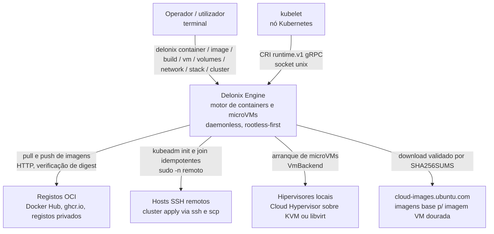
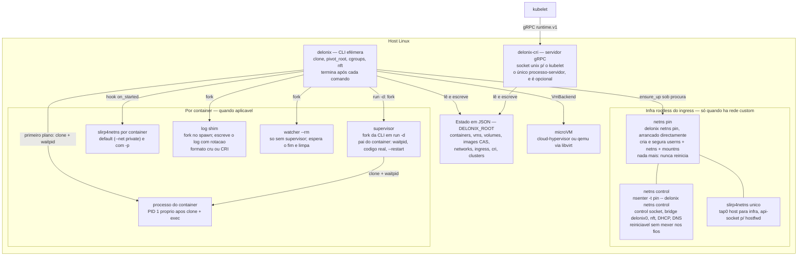
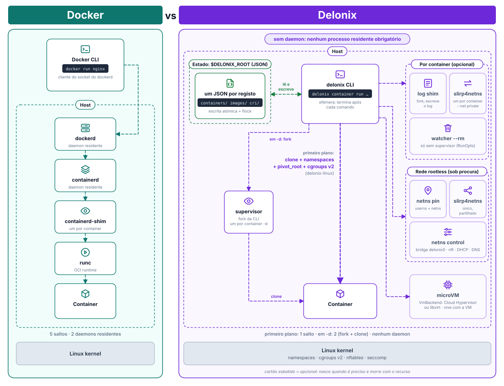
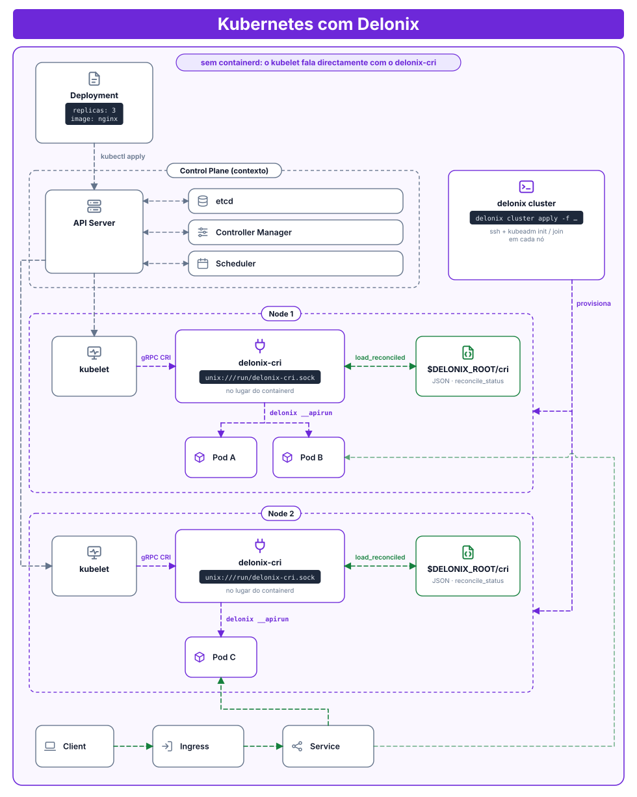
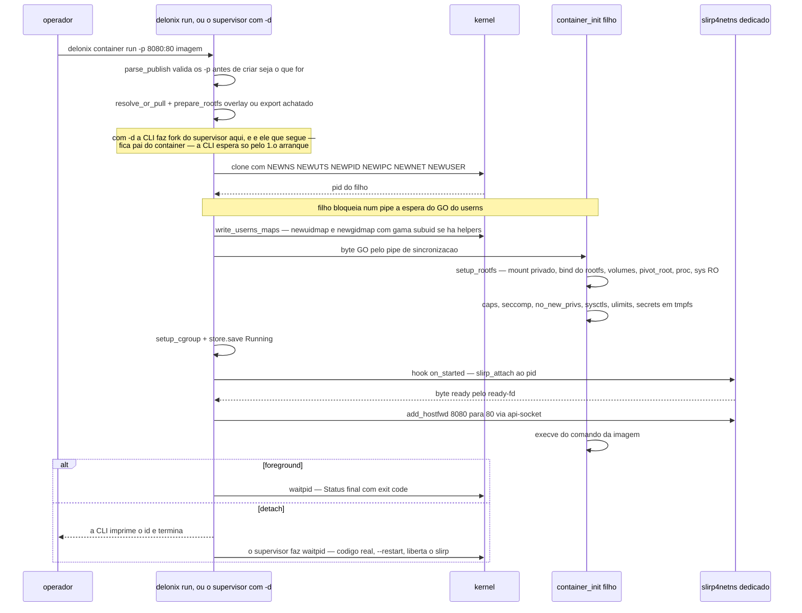
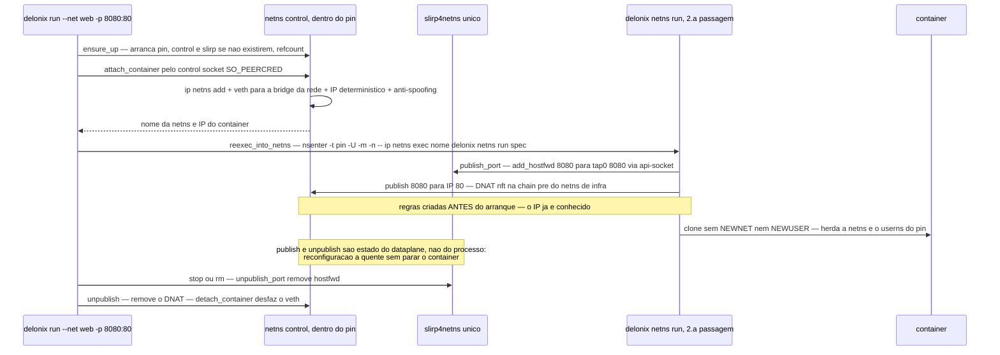
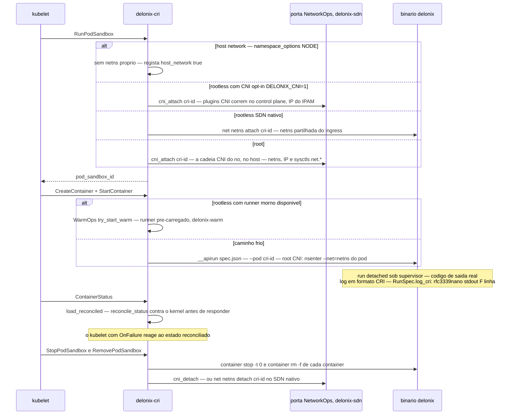
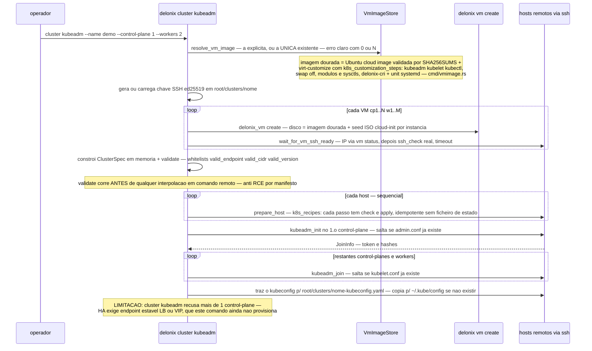

# Architecture — Delonix Engine

C4 model (Context → Containers → Components) and functional system design of the
**Delonix Engine**: a **daemonless, rootless-first, kernel-native** container and
microVM engine, written in Rust (41 crates, `crates/` workspace). This document is
canonical and kept in sync with the code — every structural claim carries a reference
to the crate/file where it was confirmed. Where limits exist, they appear in the
diagrams, not hidden away in footnotes.

Naming convention: `delonix` is the CLI binary (crate `delonix-bin`);
`delonix-cri` is the CRI server binary (crate `delonix-cri-bin`, which mounts the
engine and serves the `delonix-cri` library). The rootless ingress runs as two
processes: the **pin** (`delonix netns pin`), which creates and holds the user, network
and mount namespaces of the infrastructure, and the **control plane** (`delonix netns
control`), which runs inside them (`crates/adapters/delonix-sdn/src/infra.rs`). Before
v0.42.0 one process, the "holder", did both; code comments and this document still say
"holder" for the pair where the split does not matter.

---

## C4 — Level 1: Context

The Delonix Engine is used by a **human operator** (via the CLI), by a **kubelet**
(via CRI), and talks to external systems: OCI registries, remote SSH hosts and the
local hypervisors.



- CLI: `bins/delonix/src/main.rs` (groups `Container`/`Image`/`Build`/
  `Vm`/`Volumes`/`Network`/`Stack`/`Cluster`, one module per group under `src/cmd/`).
- CRI: `bins/delonix-cri-bin/src/main.rs` → `delonix_cri::serve_blocking`
  (`crates/interfaces/delonix-cri/src/lib.rs`) on a unix socket (`--addr` /
  `DELONIX_CRI_ADDR`, default `unix:///run/delonix-cri.sock`), the endpoint of the
  kubelet's `--container-runtime-endpoint`. `delonix serve cri` execs this binary.
- OCI registries: `crates/adapters/delonix-oci/src/registry.rs` (`pull_from_registry_with_creds`,
  `push_to_registry`, `push_oci_artifact`/`pull_oci_artifact` — this pair with
  verification of the blob digest against the manifest).
- SSH hosts: `bins/delonix/src/cmd/remote.rs` (shell-out to the system's `ssh`/`scp`,
  remote `sudo -n`).
- Hypervisors: `crates/adapters/delonix-vm/src/lib.rs` (trait `VmBackend`, implementations
  `CloudHypervisorBackend` and `LibvirtBackend`).
- Public boundary: this repository knows nothing about tenant, licence, billing or
  console — any consumer of that kind is "external" (see ADR-7).

---

## C4 — Level 2: Containers (executable units)

**There is no daemon.** No mandatory resident process exists: the CLI is ephemeral,
and the long-running processes that do exist belong to one resource each (the
supervisor of a detached container, its log shim, its slirp, a VM) or are *opt-in*
infrastructure (the rootless network plane) — each starts when it is needed and dies
with the resource it serves. Shared state is a directory of JSON files, not a daemon
socket.



Confirmation in the code, piece by piece:

| Process | Where it is born | Lifetime |
|---|---|---|
| `delonix` (CLI) | `bins/delonix/src/main.rs` | one command; in foreground it `waitpid`s the container and exits; with `-d` it returns once the supervisor reports the first start |
| `delonix-cri` | `bins/delonix-cri-bin/src/main.rs` (crate `delonix-cri-bin`); `delonix serve cri` execs it | service (e.g. the systemd unit `dist/delonix-cri.service` inside the golden VM image) |
| supervisor (`run -d`) | `run_supervised` (`crates/adapters/delonix-linux/src/supervise.rs`): a `fork` of the CLI that does the `clone` itself, so it is the container's parent; chosen by `should_supervise` (`crates/contexts/delonix-compute/src/domain/launch.rs`) for every detached start whose caller can fork | lifetime of the container, restarts included: it reaps each exit, records the real status, applies `--restart` with capped backoff, and exits when the policy says stop |
| `netns pin` | `infra::start_pin` (`crates/adapters/delonix-sdn/src/infra.rs`) spawns `<self> netns pin` directly; the pin calls `unshare(USER\|NET\|NS)` itself and the caller, still outside, writes the id maps (`crates/adapters/delonix-sdn/src/pin_userns.rs`); caught in `main.rs` before telemetry and clap (`infra::pin_main`) | lifetime of the ingress infrastructure, managed by a file-based ref-count (`infra::acquire`/`release`); it holds the namespaces and does nothing else |
| `netns control` | `infra::start_control`: `nsenter -t <pin> -U -m -n --preserve-credentials -- <self> netns control` (`infra::control_main`): sets up `delonix0` + `nft`, opens the control socket (`0600` + `SO_PEERCRED`) and runs DHCP/DNS/RA as threads | restartable: `ensure_up` starts a new one inside the surviving pin if it died, and no wire moves |
| single slirp4netns | `infra::start_slirp` — connects `tap0` to the pin's netns, with an api-socket for `add_hostfwd` | follows the pin; restarted by `ensure_up` only if it is gone |
| per-container slirp4netns | `delonix_sdn::slirp_attach` (`crates/adapters/delonix-sdn/src/lib.rs`) — called as the `on_started` hook of the `RunSpec` | lifetime of the container (dies with the netns); orphans cleaned up by `reap_orphan_slirp` |
| log shim | `fork` in the parent at `spawn` (`crates/adapters/delonix-linux/src/lib.rs`), runs `log_shim` — reads the pipe (or the pty master in console mode) and writes the log with rotation | lifetime of the container; detaches from stdio with `setsid` + `/dev/null` |
| `--rm` watcher | `spawn_rm_watcher` (`bins/delonix/src/cmd/container.rs`) — only on a detached start that is NOT supervised (`RunOpts.no_supervisor`, which no CLI flag sets) | until the container exits; performs the same cleanup as `rm -f` |
| microVM | `delonix_vm::create` — a `cloud-hypervisor` process (inside the infra netns, tap via `infra::vm_attach`) or a libvirt domain | lifetime of the VM |

State lives in `$DELONIX_ROOT` (default `/var/lib/delonix` for root,
`~/.local/share/delonix` for rootless — `infra::base_root` and
`ImageStore::default_root`): `Store`/`JsonStore`
(`crates/adapters/delonix-state/src/store.rs`) persist `Container`/`Vm` as one JSON
file per record; the CRI keeps its own records under `<root>/cri/`
(`crates/interfaces/delonix-cri/src/runtime_svc/lifecycle.rs`).

A direct consequence of being daemonless: no process watches every container (a
supervisor watches only its own, and only for a detached start), so the `Running`
state of a JSON record can diverge from the kernel. The truth is reconciled
at read time — `reconcile_status` (`crates/adapters/delonix-linux/src/lib.rs`) uses
`safe_to_signal` (PID + `starttime` from `/proc`, to close the PID-reuse window) and
reclassifies `Running`→`Crashed`/`Paused`. The CRI calls it in `load_reconciled`
before replying to the kubelet.

---

## C4 — Level 3: Components (the 41 crates)

Arrows = **real** dependencies: every normal (non-dev, non-build) dependency of one
workspace crate on another, as `cargo metadata` reports them for the `Cargo.toml` files of
`crates/*/*/` and `bins/*/` — 173 edges, grouped below by source crate. Regenerate the
list instead of editing it by hand:

```bash
cargo metadata --no-deps --format-version 1 --offline | python3 -c '
import json, sys
pk = {p["name"]: p for p in json.load(sys.stdin)["packages"]}
for n in sorted(pk):
    for d in sorted(d["name"] for d in pk[n]["dependencies"] if d["name"] in pk and d.get("kind") is None):
        print(n, "->", d)'
```

There are no cycles. `delonix-model` is the common root: 32 crates depend on it, and
the only crates with no internal dependency at all are it, `delonix-net-rules`,
`delonix-telemetry`, `delonix-warm` and `delonix-spiffe`.

```mermaid
graph TB
    BIN["delonix-bin<br>CLI delonix — um modulo por grupo em src/cmd<br>manifesto e apply, cluster kubeadm, imagens VM douradas"]
    CRI["delonix-cri<br>servidor CRI runtime.v1 — ImageService e RuntimeService<br>modulos: runtime_svc, lifecycle, streaming, spdy"]
    RT["delonix-linux<br>motor de containers: clone e namespaces, setup_rootfs,<br>cgroups v2, seccomp, caps, exec, log shim, reconcile_status"]
    NET["delonix-sdn<br>SDN rootless: modulo infra — netns pin e control, slirp unico,<br>publish e DNAT, DNS e DHCP; cni, wg WireGuard, discover"]
    IMG["delonix-oci<br>imagens OCI: registry pull e push, cas, overlay,<br>build Dockerfile, buildpack CNB, sign, internal_registry"]
    VM2["delonix-vm<br>raiz de composicao das VMs ate a P5:<br>semeia o registo e monta o VmEngine"]
    VOL["delonix-volume<br>volumes nomeados e bind mounts, sintaxe -v Docker,<br>driver local ou nfs"]
    NODECTX["delonix-node<br>contexto do no: eventos, verificacoes do host,<br>peer_cred, dispatch e as perguntas ao host e aos processos"]
    STATECRATE["delonix-state<br>estado persistido: Store e JsonStore com flock,<br>escrita atomica, SecretStore e CredVault cifrados"]
    MGMT["delonix-mgmt<br>API de gestao LOCAL (HTTP+JSON num socket unix, so o proprio uid)<br>expoe as metricas partilhadas em /metrics"]
    TEL["delonix-telemetry<br>observabilidade: logging estruturado, spans OpenTelemetry/OTLP<br>e o registo Prometheus partilhado (saiu do core na P3)"]
    SCAN["delonix-scanner<br>SBOM e varredura de CVE — image scan<br>e a imposicao de scan-on-pull"]
    SEC["delonix-security<br>decisoes de seguranca do no: politica, admissao<br>unica (container E VM), evento, score, redaccao<br>(ADR-0026) — puro, sem sensores e sem inquilino"]
    RULES["delonix-net-rules<br>regras de rede PURAS, ZERO dependencias — Cidr, nome de bridge,<br>IPAM dentro de um prefixo, leitura de taxas, o PolicyIr (ADR-0059 D6); partilhado com o PaaS"]
    SPIFFE["delonix-spiffe<br>SPIFFE identity of the node as rustls material (ADR-0102, H0):<br>X.509-SVID chain, key and trust bundle (PEM) into a rustls ServerConfig/ClientConfig;<br>external authority (SPIRE) or the engine's own CA via self_signed.<br>NO consumer in the workspace yet — hence no inbound edge"]
    CHV["delonix-provider-cloud-hypervisor<br>backend VmBackend Cloud Hypervisor (microVM por processo, api-socket)<br>(ADR-0044 P4b.4c) — saiu do delonix-vm, que o regista"]
    LVIRT["delonix-provider-libvirt<br>backend VmBackend libvirt/KVM (QEMU via virsh)<br>(ADR-0044 P4b.4b) — saiu do delonix-vm, que o regista"]
    PVE["delonix-provider-proxmox<br>backend VmBackend REMOTO contra a API de UM no Proxmox VE<br>(ADR-0008) — fora do delonix-vm por trazer cliente HTTP"]
    NAS["delonix-provider-truenas<br>provisiona dataset, quota, permissoes e export numa NAS<br>pela API do TrueNAS (ADR-0009) — mesma razao de crate a parte"]
    OPN["delonix-provider-opnsense<br>GatewayProvider REMOTO contra a API REST de UMA appliance OPNsense<br>(ADR-0051) — fora do delonix-sdn por trazer cliente HTTP"]
    PDNS["delonix-provider-powerdns<br>cliente minimo da API de UM servidor PowerDNS, com a credencial<br>do PROPRIO motor (ADR-0064 D6) — remove os registos de gateway que o no deixa"]
    MODEL["delonix-model<br>modelo partilhado PURO (foundation, ADR-0040) —<br>o Error e o dicionario DX-CDNN, Status, ContainerFw,<br>typestate, o modelo do segredo e os nomes gerados"]
    STACK["delonix-stack<br>contexto Stack (ADR-0040): tabela de Kinds,<br>reconciliador de 3 vias, Condition, revisões"]
    COMPUTE["delonix-compute<br>contexto Compute (ADR-0040): a especificacao<br>de execucao unica (RunOpts) que as entradas traduzem"]
    NETCTX["delonix-networking<br>contexto Networking (ADR-0059 D7): as portas de rede por papel<br>(GatewayProvider, NetworkZoneProvider), os registos e as marcas de posse"]
    STORCTX["delonix-storage<br>contexto Storage (ADR-0067): a porta de um driver de pool,<br>o registo de drivers, a allowlist do administrador e a marca de posse"]
    MGMTBIN["delonix-mgmt-bin<br>o executavel delonix-mgmt, que `delonix serve api` executa (P3m)"]
    MCPBIN["delonix-mcp-bin<br>o executavel delonix-mcp, que `delonix mcp` executa (P3l)"]
    NODEAPI["delonix-node-api<br>o contrato de no delonix.node.v1 SERVIDO: gRPC e HTTP/JSON<br>dos mesmos .proto num socket unix, so o proprio uid;<br>hoje NodeService (info, health, capacity, providers) e openapi.json"]
    NODEAPIBIN["delonix-node-api-bin<br>o executavel delonix-node-api, que `delonix serve node-api` executa"]
    BTRFS["delonix-provider-btrfs<br>driver de pool btrfs (ADR-0067 P2): um volume e uma subvolume<br>feita pelo proprio processo do motor; a quota qgroup so como root"]
    ZFS["delonix-provider-zfs<br>driver de pool zfs (ADR-0067 P3): um volume e um dataset<br>com refquota; ler e delegado, criar e destruir passa pelo helper"]
    LVM["delonix-provider-lvm<br>driver de pool lvm-thin (ADR-0067 P4): um volume e um LV thin<br>com ext4, criado e montado pelo helper"]
    CEPH["delonix-provider-ceph<br>suporte Ceph nativo (ADR-0081): quatro superficies de um cluster<br>pela porta Run do storage (RADOS status, RBD StoragePoolDriver de bloco,<br>CephFS por subvolume, RGW S3) — nunca a linkar librados"]
    STORHELPER["delonix-storage-helper<br>o helper PRIVILEGIADO dos pools (ADR-0067 D3, P1): um processo<br>por ligacao no delonix-storage-helper.socket, SO_PEERCRED + allowUsers;<br>tambem o create-pool/destroy-pool do administrador"]
    MCP["delonix-mcp<br>servidor MCP (ADR-0025) — superficie de IA LOCAL, sem inquilino<br>stdio-only; tools chamam Store/dominio, nunca shell arbitrario"]
    ENGINE["delonix-engine<br>raiz de composicao unica (ADR-0040 D1/A5, camada assembly):<br>escolhe o adaptador e o provider de cada porta e expoe um Engine<br>com um servico por contexto — a interface recebe-o ja montado (A5)"]
    HOST["delonix-host<br>adaptador do host (ADR-0040 R2): o mecanismo de processo-e-ficheiro<br>partilhado — escrita atomica, flock, contrato de dispatch e o peer cred<br>do socket local; adaptador de que os outros podem depender (A1)"]
    POOLHELPER["delonix-pool-helper<br>o protocolo do helper PRIVILEGIADO de pools (ADR-0067 D3, ADR-0040 R2c):<br>as operacoes que precisam de root cruzam para o delonix-storage-helper"]
    WARM["delonix-warm<br>o pool do plano morno (ADR-0095): runners pre-carregados (delonix __poolrunner)<br>que eliminam o pre_spawn do arranque a frio nos caminhos com processo vivo —<br>serve-one-then-exit, so orquestra processos e sockets"]
    CRIBIN["delonix-cri-bin<br>o executavel delonix-cri, que `delonix serve cri` executa<br>(monta o Engine e serve o CRI runtime.v1)"]

    %% delonix-bin (29)
    BIN --> COMPUTE
    BIN --> ENGINE
    BIN --> HOST
    BIN --> RT
    BIN --> MGMT
    BIN --> MODEL
    BIN --> RULES
    BIN --> NETCTX
    BIN --> NODECTX
    BIN --> IMG
    BIN --> POOLHELPER
    BIN --> BTRFS
    BIN --> CEPH
    BIN --> LVM
    BIN --> OPN
    BIN --> PDNS
    BIN --> PVE
    BIN --> NAS
    BIN --> ZFS
    BIN --> SCAN
    BIN --> NET
    BIN --> SEC
    BIN --> STACK
    BIN --> STATECRATE
    BIN --> STORCTX
    BIN --> TEL
    BIN --> VM2
    BIN --> VOL
    BIN --> WARM

    %% delonix-cri-bin (9)
    CRIBIN --> COMPUTE
    CRIBIN --> CRI
    CRIBIN --> ENGINE
    CRIBIN --> HOST
    CRIBIN --> RT
    CRIBIN --> MODEL
    CRIBIN --> NET
    CRIBIN --> TEL
    CRIBIN --> WARM

    %% delonix-mgmt-bin (7)
    MGMTBIN --> COMPUTE
    MGMTBIN --> ENGINE
    MGMTBIN --> HOST
    MGMTBIN --> MGMT
    MGMTBIN --> MODEL
    MGMTBIN --> NODECTX
    MGMTBIN --> TEL

    %% delonix-mcp-bin (7)
    MCPBIN --> COMPUTE
    MCPBIN --> ENGINE
    MCPBIN --> HOST
    MCPBIN --> MCP
    MCPBIN --> MODEL
    MCPBIN --> NODECTX
    MCPBIN --> TEL

    %% delonix-node-api-bin (15)
    NODEAPIBIN --> COMPUTE
    NODEAPIBIN --> ENGINE
    NODEAPIBIN --> HOST
    NODEAPIBIN --> RT
    NODEAPIBIN --> MODEL
    NODEAPIBIN --> NODECTX
    NODEAPIBIN --> NODEAPI
    NODEAPIBIN --> IMG
    NODEAPIBIN --> CEPH
    NODEAPIBIN --> OPN
    NODEAPIBIN --> PVE
    NODEAPIBIN --> NET
    NODEAPIBIN --> STATECRATE
    NODEAPIBIN --> TEL
    NODEAPIBIN --> VOL

    %% delonix-storage-helper (8)
    STORHELPER --> MODEL
    STORHELPER --> POOLHELPER
    STORHELPER --> BTRFS
    STORHELPER --> CEPH
    STORHELPER --> LVM
    STORHELPER --> ZFS
    STORHELPER --> STORCTX
    STORHELPER --> VOL

    %% delonix-cri (6)
    CRI --> COMPUTE
    CRI --> HOST
    CRI --> MODEL
    CRI --> NODECTX
    CRI --> SEC
    CRI --> TEL

    %% delonix-mgmt (5)
    MGMT --> COMPUTE
    MGMT --> HOST
    MGMT --> MODEL
    MGMT --> NODECTX
    MGMT --> TEL

    %% delonix-mcp (5)
    MCP --> COMPUTE
    MCP --> HOST
    MCP --> MGMT
    MCP --> MODEL
    MCP --> NODECTX

    %% delonix-node-api (7)
    NODEAPI --> COMPUTE
    NODEAPI --> HOST
    NODEAPI --> MODEL
    NODEAPI --> NODECTX
    NODEAPI --> POOLHELPER
    NODEAPI --> SEC
    NODEAPI --> STORCTX

    %% delonix-engine (10)
    ENGINE --> COMPUTE
    ENGINE --> RT
    ENGINE --> MODEL
    ENGINE --> IMG
    ENGINE --> SCAN
    ENGINE --> NET
    ENGINE --> STATECRATE
    ENGINE --> TEL
    ENGINE --> VM2
    ENGINE --> VOL

    %% delonix-compute (3)
    COMPUTE --> MODEL
    COMPUTE --> RULES
    COMPUTE --> NODECTX

    %% delonix-host (1)
    HOST --> MODEL

    %% delonix-linux (4)
    RT --> COMPUTE
    RT --> MODEL
    RT --> NODECTX
    RT --> STATECRATE

    %% delonix-networking (2)
    NETCTX --> MODEL
    NETCTX --> RULES

    %% delonix-node (1)
    NODECTX --> MODEL

    %% delonix-oci (5)
    IMG --> COMPUTE
    IMG --> HOST
    IMG --> MODEL
    IMG --> NODECTX
    IMG --> STATECRATE

    %% delonix-pool-helper (2)
    POOLHELPER --> MODEL
    POOLHELPER --> STORCTX

    %% delonix-provider-btrfs (1)
    BTRFS --> STORCTX

    %% delonix-provider-ceph (1)
    CEPH --> STORCTX

    %% delonix-provider-cloud-hypervisor (3)
    CHV --> COMPUTE
    CHV --> MODEL
    CHV --> NODECTX

    %% delonix-provider-libvirt (4)
    LVIRT --> COMPUTE
    LVIRT --> HOST
    LVIRT --> MODEL
    LVIRT --> NODECTX

    %% delonix-provider-lvm (1)
    LVM --> STORCTX

    %% delonix-provider-opnsense (3)
    OPN --> COMPUTE
    OPN --> MODEL
    OPN --> NETCTX

    %% delonix-provider-powerdns (1)
    PDNS --> MODEL

    %% delonix-provider-proxmox (3)
    PVE --> COMPUTE
    PVE --> MODEL
    PVE --> NETCTX

    %% delonix-provider-truenas (1)
    NAS --> MODEL

    %% delonix-provider-zfs (1)
    ZFS --> STORCTX

    %% delonix-scanner (2)
    SCAN --> MODEL
    SCAN --> IMG

    %% delonix-sdn (7)
    NET --> COMPUTE
    NET --> HOST
    NET --> MODEL
    NET --> RULES
    NET --> NETCTX
    NET --> NODECTX
    NET --> STATECRATE

    %% delonix-security (2)
    SEC --> MODEL
    SEC --> NODECTX

    %% delonix-stack (1)
    STACK --> MODEL

    %% delonix-state (4)
    STATECRATE --> COMPUTE
    STATECRATE --> HOST
    STATECRATE --> MODEL
    STATECRATE --> NODECTX

    %% delonix-storage (1)
    STORCTX --> MODEL

    %% delonix-vm (6)
    VM2 --> COMPUTE
    VM2 --> MODEL
    VM2 --> NODECTX
    VM2 --> CHV
    VM2 --> LVIRT
    VM2 --> STATECRATE

    %% delonix-volume (5)
    VOL --> COMPUTE
    VOL --> MODEL
    VOL --> NODECTX
    VOL --> STATECRATE
    VOL --> STORCTX
```



Notes for reading the graph (all verified against the `Cargo.toml` files and `cargo metadata`):

- **The servers are executables of their own, and the CLI execs them.** `delonix serve
  cri`, `serve api` and `serve node-api` resolve and `exec` the `delonix-cri`,
  `delonix-mgmt` and `delonix-node-api` binaries (`exec_server`,
  `bins/delonix/src/cmd/serve.rs`), and `delonix mcp` does the same for `delonix-mcp`.
  So **`delonix-bin` does NOT depend on `delonix-cri`** (an earlier version of this
  document said it did, when `serve cri` still served the CRI in-process). Each server
  is an interface crate plus a `-bin` crate: the `-bin` is the one layer allowed to name
  the assembly (`delonix-engine`) and the adapters, and it hands the interface its ports
  already filled (ADR-0040 D2.4/A5). That is why every `*-bin` crate, and `delonix-bin`
  itself, has an arrow to `delonix-engine`, and no interface crate does.
- **`delonix-cri` names no adapter that does the work.** Its internal dependencies are
  `delonix-host`, `delonix-telemetry`, `delonix-security`, the contexts
  (`delonix-compute`, `delonix-node`) and `delonix-model`
  (`crates/interfaces/delonix-cri/Cargo.toml`). Images, containers, the runtime, the
  network and the warm plane reach it as the ports `ImageOps`, `ContainerOps`,
  `RuntimeOps`, `NetworkOps` and `WarmOps` (`crates/interfaces/delonix-cri/src/lib.rs`),
  which `delonix-cri-bin` fills from `delonix-engine`, `delonix-linux`, `delonix-sdn`
  and `delonix-warm` (R3h; `bins/delonix-cri-bin/Cargo.toml`). The operations that
  `clone` are still delegated to the `delonix` binary (flow c).
- **`delonix-mgmt` is small on purpose.** It depends only on `delonix-host`,
  `delonix-telemetry`, `delonix-compute`, `delonix-node` and `delonix-model`; every
  engine use case it serves arrives through its `EngineOps` port
  (`crates/interfaces/delonix-mgmt/src/lib.rs`), implemented by `delonix-mgmt-bin` and,
  for `delonix dashboard`, by `delonix-bin` (`bins/delonix/src/cmd/engine_vms.rs`). The
  adapters that appear under `[dev-dependencies]` in its `Cargo.toml` back the tests
  only. It is local by design: unix socket, `SO_PEERCRED`, only its own uid (ADR-0010).
  It is depended on by `delonix-bin`, `delonix-mgmt-bin` and `delonix-mcp`.
- **`delonix-engine` is the composition root of the engine, not of the servers.** It
  depends on the contexts, the foundation, `delonix-telemetry` and the engine adapters
  (`delonix-linux`, `delonix-oci`, `delonix-scanner`, `delonix-sdn`, `delonix-state`,
  `delonix-vm`, `delonix-volume`) — **not** on `delonix-mcp` nor `delonix-mgmt`. The
  arrow runs the other way: the server binaries mount an `Engine` and hand it to their
  interface.
- **`delonix-linux` knows nothing about networking.** Its internal dependencies are
  `delonix-compute`, `delonix-node`, `delonix-state` and `delonix-model` — no
  `delonix-sdn`. The integration happens through inversion of control: the
  `on_started` hook of the `RunSpec` (the CLI passes closures that call `delonix-sdn` —
  `with_host_workload`, `bins/delonix/src/cmd/container.rs`).
- **`delonix-vm` does not depend on `delonix-sdn`** (P3i): the Cloud Hypervisor
  backend attaches the VM's `tap` to the ingress bridge through the `VmNetwork` port of
  `delonix-compute`, which `delonix-sdn` implements (`vm_network::HostVmNetwork`) and
  the binary registers. It does depend on the two local VM providers, which it
  registers until the application layer exists (a phase-tagged exception in
  `scripts/arch_fitness.py`).
- **`delonix-telemetry`** (P3j) holds the structured logging, the OTLP spans and the
  shared Prometheus registry. It has no internal dependency, and the foundation does
  not carry an exporter that every crate would compile just because it needed a
  `Container`.
- **`delonix-net-rules` has NOT A SINGLE dependency** — neither internal nor external,
  and that is what makes it crossable: it is what `delonix-sdn` and the `delonix-paas`
  control-plane both compile to produce the SAME bridge name, the same IP within a
  prefix, the same reading of `10mbit`. Putting that behind an HTTP endpoint would pay
  a network hop — and a new failure mode — to compute what both sides already know how
  to compute; and two implementations that MUST agree are two that one day will not.
  `delonix-sdn` re-exports everything, so no consumer changed.
- **`delonix-provider-proxmox`, `delonix-provider-truenas` and `delonix-provider-opnsense` are outside the engine
  crates on purpose, and for the same reason written in all three `Cargo.toml` files**:
  they bring an HTTP client (`reqwest`), and an engine crate does not grow one. None of
  `delonix-vm`, `delonix-volume` or `delonix-sdn` carries an HTTP client — putting the
  client to talk to ONE remote target in there would make the whole engine drag that
  tree along. That is why the Proxmox backend (ADR-0008) implements `VmBackend` and the
  OPNsense `GatewayProvider` (ADR-0051) implements the port of the `delonix-networking`
  context (ADR-0059 F2a; until then it lived in `delonix-sdn`), both from the outside,
  and they **register themselves** (`register_backend`/`register_gateway_provider`),
  with the target known only to the binaries, not to the engine.
- **`delonix-provider-powerdns` is outside for the same reason** (ADR-0064 D6): it
  talks to ONE PowerDNS server, with the credential that the operator gives to the
  ENGINE in `providers.yaml`, to remove the gateway records that the Proxmox node writes
  and never removes. It depends only on `delonix-model`; what knows WHICH records they
  are is the `delonix-networking` context (`gateway_records`) and the provider
  (`DnsProvider::reverse_zone`), and what wires them is the `-bin`.
- **Only binaries depend on the remote providers.** `delonix-provider-truenas` and
  `delonix-provider-powerdns` are used by `delonix-bin` alone; `delonix-provider-proxmox`
  and `delonix-provider-opnsense` by `delonix-bin` and `delonix-node-api-bin` (which
  lists them among the node's providers, as `delonix provider ls` does). They are leaves
  of the graph, and that is what allows a misconfigured remote target to warn and carry
  on instead of stopping a `container ls`.
- **`delonix-mcp` sits outside the engine crates, for the SAME reason as
  `delonix-mgmt`** (ADR-0025): it brings the official MCP SDK (`rmcp`) and its own
  `tokio` runtime, and no engine crate depends on it. It depends on `delonix-mgmt` to
  reuse its `VmView` port rather than redeclare it
  (`crates/interfaces/delonix-mcp/src/lib.rs`); everything else it reads arrives through
  its own `EngineReads` port, filled by `delonix-mcp-bin`. **Stdio-only at this stage**:
  a child process per AI client session, never a daemon nor a loopback socket — the
  remote/multi-tenant variant of the original design was rejected by ADR-0010 and
  belongs to `delonix-paas`, not here.
- **`delonix-warm` has no internal dependency**: it only orchestrates processes and
  sockets (the pre-loaded `delonix __poolrunner` runners, ADR-0095). `delonix-bin` and
  `delonix-cri-bin` wire it; the CRI sees it only as its `WarmOps` port.
- Internal modules that matter to the design:
  - `delonix-sdn::infra` — the whole rootless plane (`netns pin`, `netns control`,
    single slirp, publish/DNAT, DNS/DHCP/RA, per-container firewall, egress policy,
    `attach_container`); `delonix-sdn::pin_userns` — how the pin creates its own
    namespaces;
  - `delonix-sdn::wg` — WireGuard between nodes (encrypts the overlay; the control
    plane creates the interface in the infra netns);
  - `delonix-sdn::cni` — compatibility with real CNI plugins (opt-in
    `DELONIX_CNI=1`, `cni::enabled_conf`);
  - `delonix-oci::overlay` — `mount_rootfs` (overlayfs) and `export_rootfs`
    (flattening, the rootless path);
  - `delonix-oci::registry` — registry HTTP client, with digest verification;
  - `delonix-oci::buildpack` — Cloud Native Buildpacks (`CnbPlan`);
  - `delonix-state::{secret,cred_vault}` — the runtime's Secret Manager
    (`--secret`/`--secret-files`; the decrypted values only ever touch a tmpfs inside
    the container's namespace — `write_secret_files` in `crates/adapters/delonix-linux/src/lib.rs`);
  - `delonix-bin::cmd::{cluster,k8s_recipes,vmimage,remote}` — the kubeadm cluster
    plane (flow d, below).

---

## Diagrams — Docker vs Delonix, and Kubernetes with Delonix

Two drawings that answer, at a glance, why the engine is **daemonless** and
**rootless-first**, in the style of the classic "Docker vs Kubernetes" comparison:
solid title bar per panel, dashed boxes for logical boundaries, dashed arrows (panel
colour = control flow, green = data or client traffic), the kernel as a grey band at the
bottom. The labels inside the drawings are in Portuguese (pt-AO), like the operator docs.

- Source of the drawings: [`docs/diagrams/gen_diagrams.py`](docs/diagrams/gen_diagrams.py)
  — one call per box, group and arrow, with explicit coordinates. Edit it and run
  `python3 docs/diagrams/gen_diagrams.py`; commit the regenerated `.svg`.
- Each drawing has a text twin in Mermaid, next to it.
- Every box and every arrow is in the confirmation table below; what could not be
  confirmed in the code is not drawn. Line numbers were drawn at commit `6ae1321d` and
  re-anchored when the divergences below were closed (`docs/architecture-sync`); re-check
  them when the code they point at moves.

### A — Docker vs Delonix



Text twin: [`docs/diagrams/delonix-vs-docker.mermaid`](docs/diagrams/delonix-vs-docker.mermaid).

How to read it:

- **Hops between the CLI and the container.** Docker: five (`dockerd`, `containerd`,
  `containerd-shim`, `runc`), two of them resident daemons; the Docker CLI is drawn
  outside the host because it is a client of the `dockerd` socket. Delonix, in the
  foreground: one — the CLI itself does `clone` + namespaces + `pivot_root` + cgroups v2
  through `delonix-linux`. Detached (`-d`): two, drawn as a path of their own — the CLI
  forks a **supervisor (a copy of itself)** and the supervisor does the same clone,
  staying as the container's parent to collect its real exit status. The supervisor is
  the counterpart of Docker's `containerd-shim`: one per container, gone with it, not a
  shared daemon. Either way the Delonix CLI runs on the host, inside the `Host` box.
- **Everything else is optional and on demand** (faded cards). The per-container
  helpers (log shim, per-container `slirp4netns`, the `--rm` watcher) are forked when a
  container needs them; the rootless network plane (`netns pin`, `netns control`, ONE
  shared `slirp4netns`) is brought up by `ensure_up` and ref-counted; a microVM is
  another kind of workload, one process (or libvirt domain) per VM, started through a
  `VmBackend`. State is a directory of JSON files, not a daemon socket.

### B — Kubernetes with Delonix



Text twin: [`docs/diagrams/delonix-kubernetes.mermaid`](docs/diagrams/delonix-kubernetes.mermaid).

How to read it:

- Grey is Kubernetes (Deployment, Control Plane, kubelet, Ingress, Service): context,
  not code of this repository. Purple and green are Delonix.
- On each node the kubelet speaks `runtime.v1` to `delonix-cri` on
  `unix:///run/delonix-cri.sock` — there is **no containerd**. The CRI server is
  multi-threaded, so every start goes to a fresh, single-threaded `delonix __apirun`
  process, which does the clone. Before answering the kubelet, the CRI reconciles the
  record against the kernel (`load_reconciled` → `reconcile_status`).
- `delonix cluster` bootstraps the nodes over ssh + kubeadm (`init`/`join`), with
  `criSocket` pointing at `delonix-cri`.
- The drawing has exactly one arrow-on-arrow crossing (drawn as a hop; arrows do cross
  group borders, which is allowed): three sources — API Server, `delonix cluster`, the
  client — each reach both nodes, and with two nodes stacked one crossing cannot be
  avoided without crossing a card. That client arrow (Service → Pod B) is the longest
  line, so it is drawn thinner and lighter.

### C — Crate layers

Text only: [`docs/diagrams/delonix-crate-layers.mermaid`](docs/diagrams/delonix-crate-layers.mermaid).
It counts the real normal dependencies between the layers (dev-dependencies excluded).
The direction is `bins` → `assembly`/`interfaces` → `adapters` → `contexts` →
`foundation`, with `providers` beside the adapters: the contexts (which own the ports)
sit **below** the adapters (which implement them). There is no cycle between crates; at
layer level `adapters` and `providers` point at each other through different crates
(`delonix-vm` → the Cloud Hypervisor and libvirt providers it registers;
`delonix-provider-libvirt` → `delonix-host`). The interfaces no longer reach the
engine adapters directly: only `delonix-host`, `delonix-telemetry` and
`delonix-pool-helper`. To recount:

```bash
cargo metadata --no-deps --format-version 1 --offline | python3 -c '
import json, os, sys, collections
m = json.load(sys.stdin); root = m["workspace_root"]; pk = {p["name"]: p for p in m["packages"]}
def layer(p):
    r = os.path.relpath(os.path.dirname(p["manifest_path"]), root).split("/")
    return r[1] if r[0] == "crates" else r[0]
c = collections.Counter((layer(p), layer(pk[d["name"]])) for p in pk.values()
                        for d in p["dependencies"] if d["name"] in pk and d.get("kind") is None)
for (a, b), n in sorted(c.items()): print(f"{a} -> {b}: {n}")'
```

### Confirmation table — element → where it was confirmed

Names below are the English equivalents of the labels in the drawings.

| Diagram | Element | Confirmed in |
|---|---|---|
| A | Docker panel: CLI (client of the socket), host, dockerd, containerd, containerd-shim, runc, container, kernel band, and their arrows | External — the reference image plus Docker's public architecture (the shim added so the comparison does not flatter Delonix); not code of this repository |
| A | Banner "no daemon: no mandatory resident process" | Level 2 above and ADR-1; the only long-running units shipped are opt-in: [`dist/`](dist/) (`delonix-cri.service`, socket-activated `delonix-node-api` and `delonix-storage-helper`) |
| A | Host box around the Delonix side (the CLI runs on the host) | the CLI clones locally: `clone` at [`delonix-linux/src/lib.rs:9759`](crates/adapters/delonix-linux/src/lib.rs#L9759), called in-process from `cmd_run` |
| A | delonix CLI, ephemeral (`container run`) | [`bins/delonix/src/main.rs:2228`](bins/delonix/src/main.rs#L2228); `cmd_run` in [`bins/delonix/src/cmd/container.rs:3622`](bins/delonix/src/cmd/container.rs#L3622) |
| A | Arrow CLI → container (foreground) | `launch::start` at [`container.rs:4374`](bins/delonix/src/cmd/container.rs#L4374) → [`delonix-compute/src/domain/launch.rs:193`](crates/contexts/delonix-compute/src/domain/launch.rs#L193) → `HostWorkload::create` in [`delonix-linux/src/workload.rs:52`](crates/adapters/delonix-linux/src/workload.rs#L52) |
| A | Arrows CLI → supervisor ("fork") → container ("clone"), for `-d` | `should_supervise` (detach) [`launch.rs:165`](crates/contexts/delonix-compute/src/domain/launch.rs#L165); `fork` [`supervise.rs:103`](crates/adapters/delonix-linux/src/supervise.rs#L103); `create_with` inside the fork [`supervise.rs:132`](crates/adapters/delonix-linux/src/supervise.rs#L132) |
| A | Arrow CLI → per-container group | log shim forked by the in-process spawn [`delonix-linux/src/lib.rs:8966`](crates/adapters/delonix-linux/src/lib.rs#L8966); slirp hook [`container.rs:3563`](bins/delonix/src/cmd/container.rs#L3563); watcher [`container.rs:4802`](bins/delonix/src/cmd/container.rs#L4802) |
| A | Arrow CLI → microVM | `delonix_vm::create` from the CLI [`bins/delonix/src/cmd/vm.rs:3468`](bins/delonix/src/cmd/vm.rs#L3468) |
| A | clone + namespaces | `clone_flags` (NEWNS/UTS/PID/IPC/NET/USER) in [`delonix-linux/src/lib.rs:9558`](crates/adapters/delonix-linux/src/lib.rs#L9558); `clone` at [`lib.rs:9759`](crates/adapters/delonix-linux/src/lib.rs#L9759) |
| A | pivot_root | [`delonix-linux/src/lib.rs:2908`](crates/adapters/delonix-linux/src/lib.rs#L2908) (runs inside the clone) |
| A | cgroups v2 | `setup_cgroup` in [`delonix-linux/src/lib.rs:7877`](crates/adapters/delonix-linux/src/lib.rs#L7877) (unified files: `memory.max`, `cgroup.subtree_control`) |
| A | State group, `$DELONIX_ROOT` (JSON), read and written by the CLI | `Store` [`delonix-state/src/store.rs:298`](crates/adapters/delonix-state/src/store.rs#L298), `JsonStore<T>` [`:681`](crates/adapters/delonix-state/src/store.rs#L681), `default_root` [`:314`](crates/adapters/delonix-state/src/store.rs#L314), `flock` [`:23`](crates/adapters/delonix-state/src/store.rs#L23); `images/` in [`delonix-oci/src/image.rs:152`](crates/adapters/delonix-oci/src/image.rs#L152); `cri/` in [`lifecycle.rs:663`](crates/interfaces/delonix-cri/src/runtime_svc/lifecycle.rs#L663) |
| A | Supervisor (`-d`, one per detached container) | `run_supervised` [`delonix-linux/src/supervise.rs:81`](crates/adapters/delonix-linux/src/supervise.rs#L81); module doc [`supervise.rs:1`](crates/adapters/delonix-linux/src/supervise.rs#L1) |
| A | Log shim | `log_shim` [`delonix-linux/src/lib.rs:1445`](crates/adapters/delonix-linux/src/lib.rs#L1445), started at [`:8966`](crates/adapters/delonix-linux/src/lib.rs#L8966) |
| A | `--rm` watcher (only without a supervisor: `RunOpts.no_supervisor`, no CLI flag) | `spawn_rm_watcher` [`container.rs:4802`](bins/delonix/src/cmd/container.rs#L4802), reached only on the unsupervised detached path [`container.rs:4388`](bins/delonix/src/cmd/container.rs#L4388) |
| A | Per-container `slirp4netns` | `slirp_attach` [`delonix-sdn/src/lib.rs:2235`](crates/adapters/delonix-sdn/src/lib.rs#L2235), hooked at [`container.rs:3563`](bins/delonix/src/cmd/container.rs#L3563) |
| A | Rootless network group: `netns pin`, `netns control`, single `slirp4netns` | `PidKind` [`delonix-sdn/src/infra.rs:455`](crates/adapters/delonix-sdn/src/infra.rs#L455); re-exec [`main.rs:2259`](bins/delonix/src/main.rs#L2259), [`:2269`](bins/delonix/src/main.rs#L2269); `start_slirp` [`infra.rs:2592`](crates/adapters/delonix-sdn/src/infra.rs#L2592); pin creates its own namespaces: [`pin_userns.rs`](crates/adapters/delonix-sdn/src/pin_userns.rs) |
| A | Arrow CLI → rootless network ("on demand", ref-counted) | `ensure_up` [`infra.rs:1933`](crates/adapters/delonix-sdn/src/infra.rs#L1933); `acquire`/`release` [`:1783`](crates/adapters/delonix-sdn/src/infra.rs#L1783), [`:1794`](crates/adapters/delonix-sdn/src/infra.rs#L1794) |
| A | Bridge `delonix0`, nft, DHCP, DNS | [`infra.rs:28`](crates/adapters/delonix-sdn/src/infra.rs#L28), [`:1340`](crates/adapters/delonix-sdn/src/infra.rs#L1340), `start_dhcp` [`:3638`](crates/adapters/delonix-sdn/src/infra.rs#L3638), `dns_server_main` [`:9829`](crates/adapters/delonix-sdn/src/infra.rs#L9829) |
| A | microVM through `VmBackend` (Cloud Hypervisor or libvirt) | trait [`delonix-compute/src/domain/vm_backend.rs:558`](crates/contexts/delonix-compute/src/domain/vm_backend.rs#L558); [`delonix-provider-cloud-hypervisor/src/lib.rs:861`](crates/providers/delonix-provider-cloud-hypervisor/src/lib.rs#L861); [`delonix-provider-libvirt/src/lib.rs:3260`](crates/providers/delonix-provider-libvirt/src/lib.rs#L3260); registered by [`delonix-vm/src/lib.rs:220`](crates/adapters/delonix-vm/src/lib.rs#L220) |
| A | Kernel band: namespaces, cgroups v2, nftables, seccomp | rows above; `apply_seccomp` [`delonix-linux/src/lib.rs:429`](crates/adapters/delonix-linux/src/lib.rs#L429) |
| B | Deployment, Control Plane (API Server, etcd, Controller Manager, Scheduler), kubelet, Client, Ingress, Service | Kubernetes — context, drawn grey; not code of this repository |
| B | Kubernetes arrows: `kubectl apply`, API Server ↔ etcd / Controller Manager / Scheduler, API Server → kubelet, Client → Ingress → Service → pods | Kubernetes — context; the pods they reach are the ones `delonix-cri` starts (rows below) |
| B | Banner "no containerd: the kubelet talks to delonix-cri directly" | the kubelet endpoint is `delonix-cri`'s socket (row below) and ADR-6 |
| B | kubelet → `delonix-cri`, gRPC `runtime.v1` | [`delonix-cri/src/lib.rs:3`](crates/interfaces/delonix-cri/src/lib.rs#L3), [`:20`](crates/interfaces/delonix-cri/src/lib.rs#L20); `serve_blocking` [`:603`](crates/interfaces/delonix-cri/src/lib.rs#L603) |
| B | `unix:///run/delonix-cri.sock`, no containerd | [`bins/delonix-cri-bin/src/main.rs:363`](bins/delonix-cri-bin/src/main.rs#L363); [`dist/delonix-cri.service`](dist/delonix-cri.service); `criSocket` [`kubeadm_config.rs:213`](bins/delonix/src/cmd/kubeadm_config.rs#L213) |
| B | `delonix-cri` → `delonix __apirun` → pods | `delonix_bin` [`lifecycle.rs:807`](crates/interfaces/delonix-cri/src/runtime_svc/lifecycle.rs#L807) (→ [`delonix-host/src/dispatch.rs:33`](crates/adapters/delonix-host/src/dispatch.rs#L33)); `__apirun` [`lifecycle.rs:2365`](crates/interfaces/delonix-cri/src/runtime_svc/lifecycle.rs#L2365); caught in [`main.rs:2421`](bins/delonix/src/main.rs#L2421) |
| B | `$DELONIX_ROOT/cri`, `load_reconciled` / `reconcile_status` | [`lifecycle.rs:966`](crates/interfaces/delonix-cri/src/runtime_svc/lifecycle.rs#L966) → `RuntimeOps::reconcile_status` in `delonix-cri-bin` → [`delonix-linux/src/lib.rs:13353`](crates/adapters/delonix-linux/src/lib.rs#L13353) |
| B | `delonix cluster` → nodes, ssh + kubeadm `init`/`join` | `apply_one` [`cluster.rs:2443`](bins/delonix/src/cmd/cluster.rs#L2443); `kubeadm_init` [`:4683`](bins/delonix/src/cmd/cluster.rs#L4683); `kubeadm_join` [`:4840`](bins/delonix/src/cmd/cluster.rs#L4840); `ssh` [`remote.rs:123`](bins/delonix/src/cmd/remote.rs#L123) |
| C | Every layer edge and its count | `cargo metadata --no-deps` (snippet above) |

Not drawn on purpose (they exist, but are opt-in and would hide the message): the warm
plane of pre-loaded runners (`delonix-warm`, ADR-0095, used by the CRI on the rootless
isolated path); the local servers `delonix-mgmt`, `delonix-mcp`, `delonix-node-api`
and the socket-activated units in `dist/`; the Proxmox remote `VmBackend`; the Docker
API compatibility path (`cmd/dockerapi.rs`).

### Divergences found while drawing (the code wins)

Drawing these diagrams against the code at `6ae1321d` found four places where the rest
of this document had fallen behind: the Level 3 graph (24 stale edges, 50 missing), the
rootless ingress (the holder split into `netns pin` + `netns control` in v0.42.0), the
detached supervisor (limitations 4 and 6, ADR-1) and the CRI's delegation (limitation 7,
flow c). All four are now fixed in place in the sections above. Checking them also
showed that limitation 1 (rootless `--net <network>`) had been closed by the re-exec
path, and turned up one real gap, now limitation 9: `run -d --rm` does not remove the
container on the supervised path.

---

## System design — main flows

### (a) rootless `container run` — default `--net private`

By default (rootless, `--net private`) the container gets a netns of its own served
by a dedicated `slirp4netns` outbound uplink, instead of sharing the host's network —
the Podman-rootless model. `-p` adds host port-forwards on top of the same slirp;
`--net host` opts back into sharing the host netns (the former default). This is the
behaviour of `docker run` / `podman run` (`cmd_run` in
`bins/delonix/src/cmd/container.rs`; `spawn` in
`crates/adapters/delonix-linux/src/lib.rs`; `slirp_attach` in `crates/adapters/delonix-sdn/src/lib.rs`).



Structural points: the userns-GO → console/log order is critical and documented in
`spawn` (deadlock otherwise); the log shim in detach mode does `setsid` and drops stdio
so that `run -d` does not hang whoever captures its stdout; the slirp dies with the
container's netns. On the detached path the supervisor releases it on every exit
(`Supervision::on_exit`, `crates/adapters/delonix-linux/src/supervise.rs`); the orphan
reaper (`reap_orphan_slirp`) remains for the cases nobody is left to see the exit — a
killed supervisor, or a killed foreground CLI — because there is no daemon to do it.

### (b) `run --net <network> -p` — publishing through the shared ingress

With a custom network there is no per-container slirp: the control plane creates a
named netns for the container inside the infra namespaces, the CLI re-executes itself
into it, and the port is published with **one `add_hostfwd` on the single slirp + one
DNAT in the nft table inside the infra netns** (`infra::attach_container`,
`infra::publish_port`, `do_publish` — `crates/adapters/delonix-sdn/src/infra.rs`;
`attach_custom_network`/`wire_network` — `crates/contexts/delonix-compute/src/app/network.rs`;
`reexec_into_netns` — `bins/delonix/src/cmd/container.rs`).



What makes the *hot reconfig* possible: the publishing lives in the slirp (hostfwd) and
in the infra netns's nft — neither of the two belongs to the container's process.
`unpublish_ports` runs on `stop`/`rm` (`cmd/container.rs`), and `reap_orphan_hostfwds`
reconciles the slirp against the live containers when something died without cleaning
up. The same dataplane supports per-container firewall (`fw_chain_body`, dispatched in
O(1) by the verdict map `fwmap` in the `fwcont` chain), egress policy and rate-limit
(`do_netrate`).

Restricting a published port by source CIDR **works** (`net ingress allow <c>
<port> --from <cidr>`): the client address survives the hostfwd for any routable source.
The exception is the client on the host's own loopback, which arrives as the slirp
gateway (`delonix_sdn::SLIRP_GW`) because libslirp has no route back to `127.0.0.1` —
testing such a rule with `curl localhost` fails for that reason, not because of the
rule.

### (c) CRI Pod — sandbox and `join_netns`

The CRI (`crates/interfaces/delonix-cri/src/runtime_svc/lifecycle.rs`) keeps the CRI
state in its own JSON and **delegates to the `delonix` binary** the operations that use
`clone` — the server is multi-threaded (tokio) and `clone` is only safe
single-threaded (decision documented in the header of `lifecycle.rs`). It calls the
same grouped forms an operator types (`container stop`, `container rm`, `net netns
attach`/`detach`) and starts containers with the hidden re-exec `__apirun
<spec.json>`, whose file carries the whole `RunOpts` (`start_run_opts`: detached,
`--restart no`, CRI-format log). CNI goes through the `NetworkOps` port that
`delonix-cri-bin` fills from `delonix-sdn`, not through the binary.



The CRI-format logs are written by the same log shim as flow (a) —
`RunSpec.log_cri` (`crates/adapters/delonix-linux/src/lib.rs`) — so that `kubectl logs`/
`crictl logs` read the file directly. kubectl's `exec`/`attach`/`port-forward` go
through `streaming.rs`/`spdy.rs` (a dedicated streaming server, SPDY).

### (d) `cluster kubeadm` — from the golden image to the cluster

Two layers on the same foundation (`bins/delonix/src/cmd/cluster.rs`):
`cluster apply -f cloud.yaml` does the kubeadm bootstrap on hosts that are **already
alive**; `cluster kubeadm --name N --control-plane 1 --workers M` first provisions the
VMs (golden image) and then calls the **same** `apply_one` (`provision_and_apply` —
zero duplication of the kubeadm/SSH/validation logic).



`k8s_recipes.rs` is deliberately the **shared catalogue** between the golden image
build (`vmimage::build`, offline via `virt-customize`) and the live preparation over
SSH (`cluster apply`) — a host prepared by either path ends up identical.

---

## Known limitations

Each one confirmed in the code as of this document's date; several are already
annotated in the diagrams above.

1. **A rootless `--net <network>` start costs a second pass.** The named netns lives
   inside the pin's mapped user namespace, where the CLI has no privilege to `setns`.
   So the CLI attaches the container through the control socket and then re-executes
   itself into that netns — `nsenter -t <pin> -U -m -n --preserve-credentials -- ip
   netns exec <netns> delonix netns run <spec>` (`infra::join_argv`;
   `reexec_into_netns`, `bins/delonix/src/cmd/container.rs`) — and that second pass
   clones without `NEWNET`/`NEWUSER` (`Launch::inherit_userns`,
   `crates/contexts/delonix-compute/src/domain/launch.rs`). It works (an earlier version
   of this document listed it as broken), but it is one more process and one more
   `nsenter` per start, and the pin must be up for it (`ingress infra is down — no
   holder to enter` otherwise). Pod members and `--net container:<name>` take the same
   path.
2. **`delonix build` is single-stage.** A Dockerfile/Delonixfile with `FROM … AS x`
   followed by another `FROM` is rejected with a clear error (`cmd/build.rs`);
   multi-stage requires designing the rootfs hand-off between stages.
3. **`macvlan`/`ipvlan`/`overlay` have no container attach.** `network create`
   registers them in the declarative `NetworkStore` (`crates/adapters/delonix-sdn/src/lib.rs`),
   but the ingress's physical plane (`infra::network_create_with`) is only orchestrated
   for the `bridge` driver — the only one containers attach to today.
4. **`--restart` lives as long as its supervisor.** A detached container's policy is
   applied by its supervisor (`should_restart` with a capped 1s→32s backoff,
   `crates/adapters/delonix-linux/src/supervise.rs`; the policy is recorded in
   `Container.restart_policy` by `launch::start`), and across a reboot by the systemd
   units `cmd/boot.rs` writes from that field. What no process covers: a supervisor
   that is itself killed takes the policy with it until the next boot, and
   `always`/`unless-stopped` behave the same while the host is up (documented at
   `should_restart`, `crates/contexts/delonix-compute/src/domain/launch.rs`). A
   foreground run has no supervisor, so no restart. For **VMs** the policy is
   materialized only by the libvirt backend (`on_crash`); on Cloud Hypervisor it waits
   for the next `apply`/reconcile and the code warns (`restart_policy_unsupervised`,
   `crates/adapters/delonix-vm/src/lib.rs`).
5. **`cluster kubeadm` provisions only 1 control-plane.** `--control-plane > 1` is
   rejected — HA requires a stable endpoint (LB/VIP) that the command does not yet
   create. `cluster apply` already supports HA with an external `controlPlaneEndpoint`;
   only `stacked` etcd (the `external` mode is recognized and rejected); sequential
   execution across hosts (`cmd/cluster.rs`, header).
6. **The real exit code survives only while a parent is there to reap it.** In
   foreground the CLI's `waitpid` produces `Stopped`/`Failed(n)`/`Crashed`
   (`Status::from_wait`, `crates/foundation/delonix-model/src/records.rs`); with `-d` the
   supervisor does the same (`wait_and_record`) and emits `die` with `exit=<n>`. Only
   when that parent is gone — a killed supervisor or foreground CLI, or a start with
   `RunOpts.no_supervisor` — can the later reconciliation do no better than classify the
   vanished process as `Crashed` (reported as 137). A direct trade-off of being
   daemonless (see ADR-1).
7. **The CRI→CLI delegation is a process boundary with no typed contract.** The CRI
   reaches the `delonix` binary (`delonix_host::dispatch::cli_bin`) with the same
   grouped forms an operator types — `container rm -f`, `container stop -t 0`, `net
   netns attach`/`detach` (`crates/interfaces/delonix-cri/src/runtime_svc/lifecycle.rs`),
   `container exec`/`container logs -f` (`streaming.rs`, `spdy.rs`) — plus the hidden
   re-exec `__apirun <spec.json>`, which carries the whole `RunOpts` as a file
   (`lifecycle.rs`, caught in `bins/delonix/src/main.rs`). The old top-level forms
   (`run`, `stop`, `rm`, `pod create`) are gone. What remains open: a renamed
   subcommand or flag breaks the CRI only at run time — the v0.30.0 move of `netns`
   under `net` surfaced as a failed sandbox, not as a build error (the history is in the
   doc comment of `delonix_detached_why`) — and the two binaries must be installed side
   by side (`install.sh --with-cri`).
8. **`--privileged` does not start nested-systemd images like `kindest/node`** — an
   early crash in the entrypoint's cgroup detection, root cause still to isolate; there
   is already dedicated cgroup2 delegation logic for Kind nodes (`setup_node_cgroup_ns`,
   enabled by `--privileged` + the `io.x-k8s.kind.*` label), but it is not enough.
   Investigation detail in `AGENTS.md` (section "Kind-mode cluster without Docker").
9. **`run -d --rm` does not remove the container on the supervised path.** The `--rm`
   cleanup is armed only in the unsupervised branch of `cmd_run` (`spawn_rm_watcher`,
   `bins/delonix/src/cmd/container.rs`); when `launch::start` returns
   `Started::Supervised` — every detached start from the CLI — `cmd_run` returns before
   reaching it, and the supervisor's exit path (`run_supervised`) does not remove the
   record. `container run -d --rm --net none python:3.11-slim
   python3 -c 'import sys; sys.exit(3)'` leaves the container listed as `Exited (3)` (measured 2026-11-24 on `develop` at `6b8d18f3`).
   The real exit code is kept (limitation 6), the auto-removal is not.

---

## Architecture decisions (mini-ADRs)

### ADR-1 — Daemonless: no mandatory resident process

**Decision.** The runtime has no daemon: the CLI does a direct `clone` and, in the
foreground, `waitpid`s it and exits. A detached start (`run -d`) forks a **supervisor**
— a copy of the CLI, one per container, gone with it — that does the `clone` itself and
stays as the container's parent (`run_supervised`,
`crates/adapters/delonix-linux/src/supervise.rs`; `should_supervise`,
`crates/contexts/delonix-compute/src/domain/launch.rs`). It is the counterpart of
Docker's `containerd-shim` or podman's `conmon`, not of `dockerd`: nothing is shared
between containers. State is shared through JSON files; the other auxiliary processes
(log shim, slirp, the rootless network plane) are born out of necessity and die with
the resource.
**Why.** Less attack and failure surface (there is no `dockerd` whose fall takes the
containers down with it); instant startup; auditability — each process has an obvious
owner and lifecycle. The supervisor exists because only a parent can `waitpid`: without
it a detached container's exit code died with the reparenting to `init`, and
`on-failure` had nothing to decide on.
**Trade-offs accepted.** The supervisor keeps the exit code and the restart policy only
while it lives: a killed supervisor leaves the container to `init`, and from then on the
exit code is lost and the policy waits for the next boot (limitations 4 and 6). No
process watches every container, so the truth about "is it alive?" is reconstructed at
read time (`reconcile_status` + `safe_to_signal` against PID reuse) instead of being
kept by events; and orphan cleanup still needs explicit reapers (`reap_orphan_slirp`,
`reap_orphan_hostfwds`) for the exits nobody saw. An optional `delonixd` is an
evolution that has been discussed, not an existing piece.

### ADR-2 — Rootless-first with subuid/newuidmap

**Decision.** The rootless path is the main design, not a degraded mode:
`CLONE_NEWUSER` + `write_userns_maps`, which uses the full subuid/subgid range via
`newuidmap`/`newgidmap` when the helpers exist (`have_subid_helpers`,
`crates/adapters/delonix-linux/src/lib.rs`), with a fallback to a single-uid map.
**Why.** Running real images (nginx does `chown` to uid 101; `USER` ≠ 0 via
`RunSpec.run_uid`) requires a range of uids, not just the mapped root. The
rootless→root boundary was audited offensively (the control plane validates `SO_PEERCRED`;
`join_netns` only receives server-side generated paths; no mapping path reaches the
host's real uid 0).
**Trade-off.** Two code regimes at sensitive points (e.g. `setup_dev` before the pivot
as root vs `setup_dev_userns` after the setuid) and a dependency on the system's
helpers.

### ADR-3 — Shared ingress (pin + control + single slirp) vs one slirp per container

**Decision.** Two models coexist: `-p` without a custom network uses one `slirp4netns`
per container (simple, dies with it); custom networks use the **shared ingress** — an
infra netns with the `delonix0` bridge, ONE slirp as a host↔infra bridge and DNAT nft
inside it (`crates/adapters/delonix-sdn/src/infra.rs`; the module doc says it
eventually replaces the 1-slirp-per-container model). Since v0.42.0 the ingress runs as
two processes: the **pin** (`delonix netns pin`) creates the user, network and mount
namespaces itself — `unshare(2)` inside the process, with the caller writing the id
maps from outside (`crates/adapters/delonix-sdn/src/pin_userns.rs`) — and then only
holds them; the **control plane** (`delonix netns control`, started with `nsenter` into
the pin) owns the control socket, the bridge, `nft`, DHCP and DNS. Neither is started
through `unshare(1)` any more: with `kernel.apparmor_restrict_unprivileged_userns=1`
the namespace creator has to be the engine's own executable, which is what an AppArmor
profile is attached to.
**Why.** The ingress gives networking between containers (common bridge, internal
DNS/DHCP), per-container firewall/egress/rate-limit and — because publish/unpublish are
dataplane state — hot port reconfiguration. One slirp per container gives none of these.
The split is what makes the control plane restartable: `ensure_up` finds the pin alive
and starts a new control inside it, and not a veth, tap, nft rule or slirp moves
(`ensure_up_locked`). Before it, restarting the single holder threw the netns away and
unplugged every workload on the node.
**Trade-offs.** Three long-running infra processes (pin, control, slirp — managed by a
ref-count, not by a daemon); all configuration inside the netns has to be executed by
the control plane, already root in the userns (there is no `nsenter --user --net` from
the host — a gotcha documented in the module); and a rootless start on a custom network
pays the second pass of limitation 1.

### ADR-4 — State in JSON files, not in a DB

**Decision.** Persistence by one-JSON-per-record (`Store`/`JsonStore`,
`crates/adapters/delonix-state/src/store.rs`) under `$DELONIX_ROOT`; the CRI and the
ingress follow the same pattern (pid/refcount/status files).
**Why.** Without a daemon there is no natural owner for a DB; files are inspectable
(`cat`), survive crashes of any process and add no dependencies. Compatibility with old
formats is done in `Deserialize` (e.g. `Status` accepts the legacy `{"Exited": code}`).
**Trade-offs.** No transactions nor queries; coherence with the kernel is eventual
(reconciliation at read time); concurrency resolved case by case (lockfile on the
ingress refcount).

### ADR-5 — Stateless idempotency in `cluster apply` (Terraform without tfstate)

**Decision.** Each host preparation step is a `check`/`apply` pair
(`HostRecipe`, `cmd/k8s_recipes.rs`); `kubeadm_init`/`kubeadm_join` check
`/etc/kubernetes/{admin,kubelet}.conf` on the host before acting. There is no local
state file.
**Why.** The real condition on the host is the only truth — it never drifts from a
`.tfstate` because there is none; re-running the `apply` is always safe. The catalogue
is shared with the golden image build so the two paths never diverge.
**Trade-offs.** Each run re-checks everything (slower, sequential today). The local
`stack apply` shares the absence of a state file, but since v0.47.0 it **converges**: it
computes a plan (`stack plan`) and hot-reconfigures ports, volumes, networks, memory and
CPU, without changing the PID, rejecting with the field name whatever would force a
recreation. It is still fail-fast with no rollback, and still convergence **on demand**
— a continuous reconciliation loop is, by decision, the work of an external orchestrator
and not of this runtime.
**Security note.** Everything that enters a remote command is validated by a whitelist
before any interpolation (`valid_endpoint`/`valid_cidr`/`valid_version`,
`cmd/cluster.rs`) — `shell_quote` protects the ssh boundary, never the content.

### ADR-6 — CRI as the Kubernetes boundary (and not an embedded kubelet)

**Decision.** The k8s integration is exclusively the `runtime.v1` server
(`crates/interfaces/delonix-cri`): the kubelet commands, Delonix executes. The server
delegates the operations with `clone` to a single-threaded process and keeps the CRI
state apart (`lifecycle.rs`).
**Why.** The CRI is the ecosystem's stable and narrow interface — Delonix replaces
containerd/CRI-O without inventing a protocol; scheduling/restart/GC stay on the
kubelet's side, consistent with being daemonless (the kubelet is the monitor the runtime
does not have). The golden VM image already packages `delonix-cri` as a systemd service,
closing the loop with flow (d).
**Trade-off.** Limitation 7 (the CRI→CLI delegation is an untyped process boundary)
is the open price of keeping `clone` out of the multi-threaded server.

### ADR-7 — Public/private boundary with the PaaS

**Decision.** This repository compiles on its own and knows nothing about tenant,
licence, billing or console. `delonix-model` and the contexts are the base that the
private side re-exports — never the other way around (crate doc). What stays **here** are
the pieces that are genuine runtime/SDN mechanism: Secret Manager (`secret`/`cred_vault`),
the overlay's WireGuard (`wg.rs`). What stays **outside** are the platform policies (who
publishes what, plans, quotas) — the diagrams stop at the "external consumer".
**Why.** An auditable open-source engine demands a closed dependency tree
(`cargo tree -e normal` with no private crates) and a clear line between mechanism and
policy.
**Trade-off.** Some apparent duplication of concepts between the two sides (e.g. a
runtime secrets vault vs a platform vault) is deliberate, not accidental.
