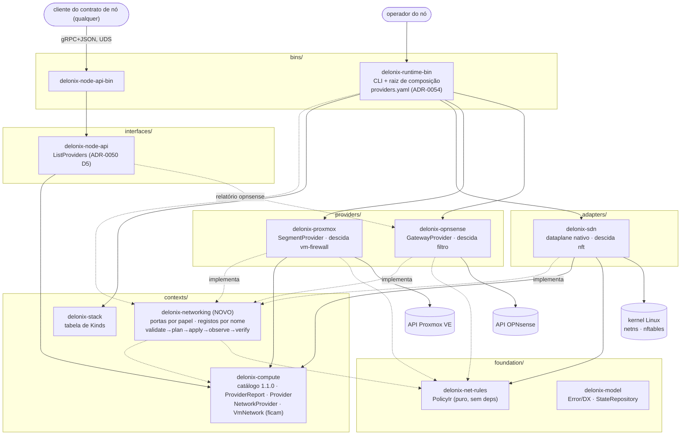
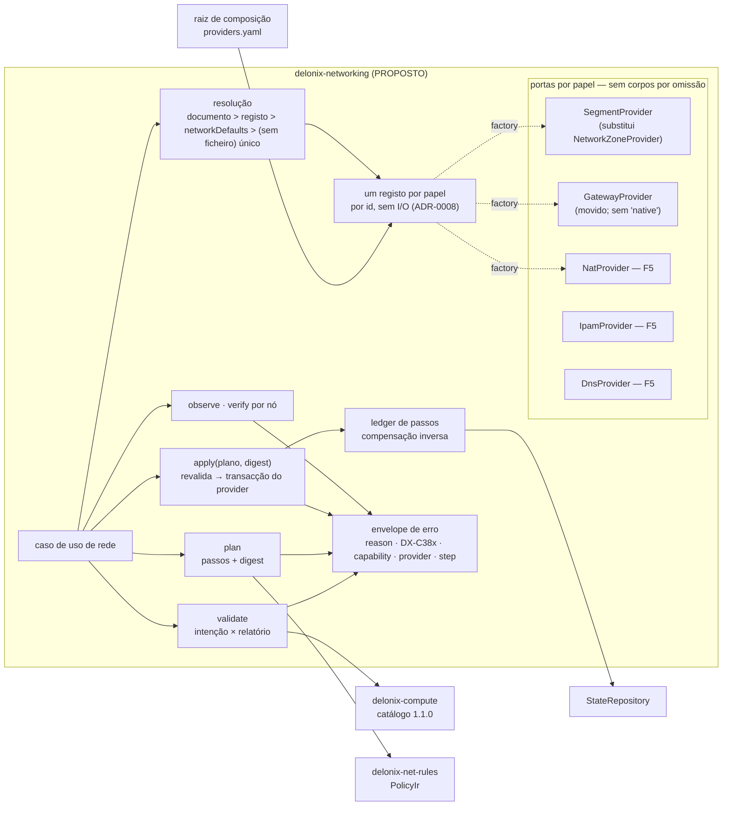

# 64 — ADR-0059 spike: what network providers can say about themselves, measured

**Date:** 2026-09-27 · **Baseline:** measured on `origin/main` `d3d6f394` (v4.4.0 + 68); reread against `f46a73e9` (+ #544, #541, #545 and #542; the cited lines were re-checked) ·
**ADR:** [0059](../adr/0059-network-providers-by-role-lifecycle-and-policy-ir.md) (Proposed) ·
**Origin:** audit 62 (`docs/discovery/62_NAAS_FASE0_AUDITORIA.md`, #544), §7 session S5 and §10 question 3.

Nothing in this spike writes to a provider. Three sources, each with what it proves and what it doesn't:

| Source | How | Proves |
|---|---|---|
| The code and the published matrix | reading on `origin/main` | what the engine **declares** today |
| Proxmox lab node `pve-lab-475` (PVE 9.2.2) | read-only `GET`s to the API, and the node's own `apidoc.js` | what a remote provider **actually answers**, and what it allows to be discovered |
| Engine's OPNsense 26.1.2 image (`opnsense:26.1`) | `guestfish --ro` on the image, without booting anything | which API modules the appliance **ships with** — not that they respond |

## 1. The question

ADR-0059 decides on a 1.1.0 catalogue with `net.gateway.*`, `net.nat.*`, `net.lb.*`,
`net.dns.*`, `net.ipam.*`, `net.apply.*` rows, a `ProviderKind::Gateway` and per-role
ports. The spike answers: (a) what the engine declares for networking today; (b) what
facts a remote provider gives to fill these rows by **discovery** rather than by name;
(c) whether the proposed names have an API on the other side to serve them, or whether
they stay `not-implemented` / `unsupported`.

## 2. What the engine declares today (code and matrix, `d3d6f394`)

- `docs/providers/capability-matrix.md` (generated, matching `delonix provider matrix`
  by test): `network` section with **20 rows** — `linux` 7 supported, 10 partial, 2
  unsupported, 1 external; `proxmox` **0 supported**, 5 partial, 6 unsupported, 9
  not-implemented. **No `opnsense` row exists**: `GatewayProviderRegistration`
  (`crates/adapters/delonix-sdn/src/gateway.rs`) has no `ReportFactory`, and the report
  list is assembled twice without it (`cmd/provider.rs:117`,
  `delonix-node-api/src/providers.rs:18`).
- Proxmox's network report (`delonix-proxmox/src/lib.rs:6300`) gives `net.ipam` and
  `net.dns` as `not-implemented`, even though the SDN client has IPAM and DNS routes
  tested live (ADR-0049 slice 2, #500). This is **correct**: no port reaches them from a
  Kind. It's exactly the gap ADR-0059's F5 closes.
- Four network ports, four different shapes (the ADR-0059 Context table). The
  `NetworkZoneRecord` doesn't store the provider (`cmd/network_zone.rs:71`).

## 3. Proxmox SDN, live and read-only

Target: `https://192.168.122.91:8006` (VM `pve-lab-475` on `qemu:///system`, already
running), ticket authentication with the test credential documented in
`crates/providers/delonix-proxmox/tests/live.rs`. Calls made, all `GET`:

```
/version                         {"release":"9.2","version":"9.2.2"}
/cluster/status                  cluster lab: nodes pve and pve2 online, quorate
/cluster/sdn                     vnets zones controllers ipams dns fabrics prefix-lists route-maps
/cluster/sdn/zones[?pending=1]   []            /cluster/sdn/vnets[?pending=1]  []
/cluster/sdn/controllers         []            /cluster/sdn/dns                []
/cluster/sdn/fabrics/all         {"fabrics":[],"nodes":[]}
/cluster/sdn/ipams               [{"type":"pve","ipam":"pve","digest":"1ccae0c2…"}]
/cluster/sdn/ipams/pve/status    [{"subnet":"10.250.7.0/24","zone":"prfz","vnet":"prfv",
                                   "ip":"10.250.7.1","gateway":1}]
/cluster/firewall/options        {"enable":1,"digest":"bb9ed914…"}
/nodes/pve/firewall/options      {"digest":"da39a3ee…"}          ← no "nftables"
/nodes/pve/services              proxmox-firewall running · pve-firewall running
/nodes/pve/apt/versions          libpve-network-perl 1.6.5 · proxmox-firewall 1.2.3 ·
                                 pve-firewall 6.0.4 · dnsmasq 2.91 · ifupdown2 3.3.0
```

And from the `apidoc.js` served by the node itself (`/pve-docs/api-viewer/apidoc.js`,
4.27 MB), the parameters that decide catalogue rows:

```
POST /cluster/sdn/zones            type ∈ {evpn, faucet, qinq, simple, vlan, vxlan}
                                   ipam, dns, dhcp ∈ {dnsmasq}, mtu, exitnodes, lock-token
POST /cluster/sdn/vnets/{v}/subnets  snat (masquerade), dhcp-range, gateway, lock-token
POST /cluster/sdn/ipams            type ∈ {netbox, phpipam, pve}
POST /cluster/sdn/dns              type ∈ {powerdns}
POST /cluster/sdn/lock             allow-pending (by default: refuses if there are pending changes)
DELETE /cluster/sdn/lock           lock-token, force
POST /cluster/sdn/rollback         lock-token, release-lock
PUT  /cluster/sdn                  lock-token, release-lock
POST /cluster/sdn/vnets/{v}/firewall/rules  type ∈ {in,out,forward,group}, action, proto,
                                   pos, log, icmp-type
```

### What this decides

1. **There is a native transaction.** The global lock refuses by default while another
   party's changes are pending, and accepts a `rollback` with the token before applying.
   #542 (merged during this session) already uses and measured it
   (`Client::sdn_transaction`, `sdn_lock.rs:452`, DX-5516/9525). For ADR-0059:
   `net.apply.staged` and `net.apply.rollback` can be born `supported` on Proxmox, with
   the live test `sdn_routing_chain_vnet_firewall_and_the_lock_round_trip_through_the_node`
   as evidence; and "no third-party pending changes" (S6) is a precondition the node
   itself enforces.
2. **There is a per-object digest** (IPAM, firewall options). It feeds D4's `observe`
   fingerprint — a plan goes stale when an object it uses changes digest, without having
   to diff the whole body.
3. **Observed drift, not assumed.** The `pve` IPAM stores `10.250.7.0/24` from zone
   `prfz` / VNet `prfv`, which **no longer exist** (empty zones and VNets, in pending too).
   An earlier run deleted the zone and left the reservation. Not fixed here (out of
   scope for this spike, and the node is shared with #542's session); it stays as a test
   case for `observe` and the ownership marker: with no marker, nobody knows whether
   `prfz` belonged to the engine.
4. **One row depends on the host, not the provider.** Both firewall services run, but
   the host's `nftables` option is not set: per #542, VNet firewall rules end up
   **staged but not applied** in that case. In the discovered report, VNet `firewall.*`
   is `unavailable-on-host` here — never `supported` just because it's Proxmox.
5. **An apply's verdict covers only the entry node** (measured in #542 on the same lab:
   `reloadnetworkall` OK while pve2's `srvreload` failed). That's the reason for D4's
   per-node `verify`.
6. **What exists on the other side for the new roles:** segment (6 zone types; the
   engine only creates `simple`), external IPAM (3 plugins), DNS (PowerDNS only), DHCP
   (dnsmasq), source NAT (subnet `snat`), EVPN egress gateway (`exitnodes`). **There is
   no** load balancer nor DNAT/port-forward in the SDN.

### Discovered `proxmox`/`network` report (draft in the 1.1.0 names — not code)

| Row | Proposed state | Why |
|---|---|---|
| `net.segment.remote` | partial | `kind: NetworkZone` creates a `simple` zone + VNets; no live test of the Kind (ADR-0049 addendum) |
| `net.ipam.provider` | not-implemented | live client (#500), no port — F5 |
| `net.ipam.reservation` | not-implemented | live `PUT …/vnets/{v}/ips`, no port |
| `net.ipam.dhcp` | not-implemented | live `dhcp-range`, no port |
| `net.dns.records` | requires-external-component | PowerDNS only, which the engine doesn't ship |
| `net.nat.snat` | not-implemented | subnet `snat` exists; no port |
| `net.nat.dnat`, `net.nat.one-to-one`, `net.lb.*` | unsupported-by-provider | the SDN doesn't have it |
| `net.apply.staged`, `net.apply.rollback` | supported | live:`crates/providers/delonix-proxmox/tests/live.rs::sdn_routing_chain_vnet_firewall_and_the_lock_round_trip_through_the_node` (#542) |
| `net.observe` | partial | reading zones/VNets/IPAM exists; no comparison with the registry |
| `net.verify.dataplane` | not-implemented | no traffic probe |
| `net.ownership-marker` | not-implemented | S6 |
| `firewall.*` (VNet) | unavailable-on-host on this node | host's `nftables` off (point 4) |

## 4. OPNsense 26.1.2, from the image, without booting

The `opnsense-adr0051-spike` appliance is **off** and this session doesn't have the API
key (it was hand-minted in ADR-0051's phase 0 and wasn't left anywhere readable). The VM
wasn't started: the host is shared and ADR-0051 treats that as the owner's decision.
Instead, the published image was opened read-only:

```bash
export SUPERMIN_KERNEL=/boot/vmlinuz-7.0.0-30-generic SUPERMIN_MODULES=/lib/modules/7.0.0-30-generic LIBGUESTFS_BACKEND=direct
guestfish --ro -a ~/.local/share/delonix/vm-images/opnsense_26.1.qcow2
# run; mount-vfs ro,ufstype=ufs2 ufs /dev/sda /   (UFS2 on the whole disk, no partition table)
```

`/usr/local/opnsense/version/core`: `CORE_VERSION 26.1.2`, `CORE_PKGVERSION 26.1.2_5`,
`CORE_HASH 685ed6be1`. API controllers present
(`mvc/app/controllers/OPNsense/<Module>/Api/`):

| Module | Controllers | Catalogue row it could serve |
|---|---|---|
| Firewall | `Alias`, `AliasUtil`, `Category`, `Filter`, `FilterBase`, `FilterUtil`, `Group`, `DNat`, `SourceNat`, `OneToOne`, `Npt`, `Migration` | `net.gateway.filter/alias/update-in-place/rule-order`, `net.nat.dnat/snat/one-to-one/npt`, `net.ownership-marker` (categories) |
| Routes, Routing | `Gateway`, `Routes`, `Settings` | `net.gateway.multi-wan` (gateways and groups) |
| Unbound | `Settings`, `Service`, `Overview`, `Diagnostics` | `net.dns.records` (resolver overrides) |
| Kea, Dnsmasq | `Dhcpv4`, `Dhcpv6`, `Leases*`, `Settings` | `net.ipam.dhcp`, `net.ipam.reservation` |
| IPsec, OpenVPN, Wireguard | — | `net.gateway.vpn` |
| Interfaces | `Vlan`, `Vxlan`, `Bridge`, `Vip`, `Lagg`, … | out of scope (appliance administration) |
| **no** HAProxy/relayd | — | `net.lb.*` = `requires-external-component` (`os-haproxy` plugin) |

From `FilterBaseController.php` and the `Filter.xml` model:

- **Apply with automatic rollback exists:** `savepointAction`, `applyAction($rollback_revision)`
  (arms a `filter rollback_timer` timer), `cancelRollbackAction`, `revertAction`. The
  engine's client (`delonix-opnsense`) calls only `apply` with no revision. →
  `net.apply.rollback` `partial` (the API exists, never exercised).
- **Update and ordering exist in the API, not in the client:** `setRule`, `moveRuleBefore`,
  `toggleRuleLog`. → `net.gateway.update-in-place` and `net.gateway.rule-order`
  `not-implemented` (ADR-0051 refused to guess `set_rule`'s shape).
- **A rule has** `sequence`, `log`, `statetype ∈ {keep, sloppy, modulate, synproxy, none}`,
  `categories`, `ipprotocol ∈ {inet, inet6, inet46}`, `direction ∈ {in, out, any}`,
  `action ∈ {pass, block, reject}`. For D6's IR: `stateful: false` maps down to
  `statetype: none`; `log` to `log`; order to `sequence`; a pair per namespace/selector
  **has nowhere to map down to** and is refused.

### Declared `opnsense`/`gateway` report (draft — not code)

| Row | Proposed state | Evidence / why |
|---|---|---|
| `net.gateway.filter`, `net.gateway.alias` | supported | `crates/providers/delonix-opnsense/tests/live.rs` (ADR-0051 phase 2) |
| `net.apply.staged` | supported | same test: stage + `filter/apply` + `alias/reconfigure` |
| `net.gateway.update-in-place`, `net.gateway.rule-order` | not-implemented | API present, client isn't |
| `net.apply.rollback` | partial | `savepoint`/`apply(rev)`/`cancelRollback` on the image, never exercised |
| `net.nat.dnat/snat/one-to-one/npt` | not-implemented | controllers present, no client |
| `net.gateway.multi-wan`, `net.gateway.vpn` | not-implemented | modules present, outside F1–F5 |
| `net.dns.records`, `net.ipam.dhcp/reservation` | not-implemented | Unbound/Kea present |
| `net.lb.*` | requires-external-component | no controller on the image |
| `net.ownership-marker` | not-implemented | `categories` is the candidate — S6 decides |
| `net.namespace-isolation`, `firewall.workload-peer`, the remaining local `net.*` | unsupported-by-provider | the appliance doesn't know the engine's namespaces |

## 5. C4 of the proposed design

Drawn by the agent `martin` from the code on `d3d6f394` (solid arrows = exists;
dashed = proposed). It only goes into `ARCHITECTURE.md` if the ADR is accepted.

### 5.1 Level 2 — crates by layer



The `("dep","delonix-opnsense","delonix-sdn")` and
`("dep","delonix-proxmox","delonix-sdn")` exceptions disappear
(`scripts/arch_fitness.py:140,147`). The `net → comp` arrow is the only one between the
two contexts; `comp → net` is forbidden (ADR-0059 D7).

### 5.2 Level 3 — inside `delonix-networking`



### 5.3 Sequence — `stack apply` of a `kind: NetworkZone`

```mermaid
sequenceDiagram
  autonumber
  actor Op as operador do nó
  participant CLI as delonix-runtime-bin
  participant UC as delonix-networking
  participant Reg as registo segment
  participant Px as delonix-proxmox
  participant PVE as API Proxmox VE
  participant St as StateRepository
  Op->>CLI: stack apply -f zona.yaml
  CLI->>Reg: providers.yaml → register("proxmox") (sem I/O)
  CLI->>UC: validate(documento)
  UC->>St: registo da zona (provider que a serviu?)
  UC->>Reg: resolve: registo > networkDefaults.segment
  break sem nome, ou nome não registado para o papel
    UC-->>CLI: invalid_intent / unsupported_capability
  end
  UC->>Px: capabilities() → linhas requeridas
  break linha não utilizável
    UC-->>CLI: unsupported_capability (linha, estado, detalhe)
  end
  UC->>Px: observe(zona)
  Px->>PVE: GET zones, vnets, digests
  UC->>UC: plano + digest(intenção, observado, provider, catálogo)
  CLI->>UC: apply(plano, digest)
  UC->>Px: observe de novo
  break digest diferente
    UC-->>CLI: stale_plan — nada escrito
  end
  UC->>Px: transacção (POST /cluster/sdn/lock, recusa com pendentes alheios)
  loop cada passo (zona, depois VNets)
    UC->>St: ledger: passo pendente
    UC->>Px: ensure_* (com lock-token)
    UC->>St: ledger: passo feito
  end
  alt falha antes de activar
    UC->>Px: POST /cluster/sdn/rollback
    UC-->>CLI: o erro do passo (reason, DX, step) + ledger; nada activado
  else activa
    UC->>Px: PUT /cluster/sdn (token, release-lock=1)
    UC->>Px: verify em cada nó (pve, pve2)
    UC->>St: registo {vnets, provider: "proxmox"}
    UC-->>CLI: aplicado; verified: control-plane-only
  end
```

## 6. What this spike did NOT validate

- No write, lock or rollback (the Proxmox lock was measured by #542, not here; OPNsense's
  automatic rollback was never exercised).
- The OPNsense API actually responding: the image proves the controllers exist, not that
  the configured appliance responds, nor the shape of the bodies (only `filter`/`alias`
  were measured, in ADR-0051's phase 0).
- The reports above as code, and D6's golden equivalence table.
- The second node (`pve2`) by its own call: per-node state came from #542.
- The origin of the orphaned `prfz`/`prfv` reservation — logged, not investigated.

## 7. Reproduce

```bash
# Proxmox (read-only): ticket with the tests/live.rs credential, then
curl -sk -b "PVEAuthCookie=$TICKET" https://192.168.122.91:8006/api2/json/cluster/sdn/ipams/pve/status
curl -sk https://192.168.122.91:8006/pve-docs/api-viewer/apidoc.js -o apidoc.js   # per-route parameters
# OPNsense (offline): the guestfish from §4, then
#   ls /usr/local/opnsense/mvc/app/controllers/OPNsense/Firewall/Api
#   cat /usr/local/opnsense/version/core
```
