# Architecture report — the measured layering

> Generated by `scripts/arch_report.py` (ADR-0040 C2). A pure function of the
> tree: the diff against `main` is the architectural change, nothing else.

## Lines per layer

| Layer | Crates | Lines | Share |
| --- | ---: | ---: | ---: |
| foundation | 2 | 4,785 | 1.4% |
| context | 6 | 30,669 | 8.7% |
| adapter | 8 | 79,034 | 22.5% |
| provider | 10 | 54,557 | 15.5% |
| interface | 4 | 31,716 | 9.0% |
| bin | 5 | 150,715 | 42.9% |
| **total** | **35** | **351,476** | 100% |

## Lines per crate

### foundation

| Crate | Lines |
| --- | ---: |
| delonix-model | 3,664 |
| delonix-net-rules | 1,121 |

### context

| Crate | Lines |
| --- | ---: |
| delonix-compute | 14,046 |
| delonix-networking | 5,539 |
| delonix-storage | 3,353 |
| delonix-security | 3,286 |
| delonix-stack | 3,087 |
| delonix-node | 1,358 |

### adapter

| Crate | Lines |
| --- | ---: |
| delonix-sdn ⚠️ >20k | 29,139 |
| delonix-linux ⚠️ >20k | 22,351 |
| delonix-oci | 13,554 |
| delonix-vm | 4,955 |
| delonix-volume | 3,317 |
| delonix-state | 3,010 |
| delonix-scanner | 1,564 |
| delonix-telemetry | 1,144 |

### provider

| Crate | Lines |
| --- | ---: |
| delonix-provider-proxmox ⚠️ >20k | 31,590 |
| delonix-provider-libvirt | 6,617 |
| delonix-provider-opnsense | 5,242 |
| delonix-provider-cloud-hypervisor | 3,543 |
| delonix-provider-ceph | 2,077 |
| delonix-provider-lvm | 1,271 |
| delonix-provider-truenas | 1,189 |
| delonix-provider-powerdns | 1,064 |
| delonix-provider-btrfs | 1,002 |
| delonix-provider-zfs | 962 |

### interface

| Crate | Lines |
| --- | ---: |
| delonix-node-api | 16,883 |
| delonix-cri | 9,784 |
| delonix-mgmt | 3,291 |
| delonix-mcp | 1,758 |

### bin

| Crate | Lines |
| --- | ---: |
| delonix-runtime-bin ⚠️ >20k | 149,411 |
| delonix-storage-helper | 645 |
| delonix-node-api-bin | 436 |
| delonix-mcp-bin | 140 |
| delonix-mgmt-bin | 83 |

## CLI lines by Part D destination

Where each `bins/delonix-runtime-bin/src/cmd` module's business rule goes.
Context destinations (the `cli_context_lines` ratchet) come first.

| Destination | Lines | Modules | Context? |
| --- | ---: | ---: | :---: |
| delonix-compute | 23,694 | 7 | ✓ |
| delonix-stack | 21,380 | 10 | ✓ |
| delonix-networking | 19,312 | 25 | ✓ |
| delonix-artifact | 15,763 | 6 | ✓ |
| delonix-cluster | 13,590 | 10 | ✓ |
| delonix-storage | 9,352 | 8 | ✓ |
| delonix-node | 7,183 | 4 | ✓ |
| delonix-gateway | 5,252 | 2 | ✓ |
| delonix-security | 2,796 | 3 | ✓ |
| delonix-cli | 16,318 | 17 |  |
| delonix-docker-api | 3,814 | 1 |  |
| delonix-engine | 3,066 | 4 |  |
| delonix-l7proxy | 2,024 | 1 |  |
| delonix-linux | 1,238 | 1 |  |
| delonix-sdn | 471 | 1 |  |
| delonix-git | 449 | 1 |  |
| delonix-ssh | 274 | 1 |  |
| tests | 256 | 1 |  |
| delonix-mcp | 36 | 1 |  |
| **context total** | **118,322** | | |

## Ratchets

Each entered at its value on `64a5953a`; the gate fails if any rises, or
falls without the baseline lowered in the same commit.

| Ratchet | Now | Baseline | Target |
| --- | ---: | ---: | --- |
| self_exec_sites | 35 | 35 | 0 (R5) |
| library_prints | 109 | 109 | down |
| env_writes | 23 | 23 | down |
| shared_error_imports | 3 | 3 | 0 |
| raw_error_variant_matches | 0 | 0 | 0 |
| context_spawns | 0 | 0 | 0 |
| cli_context_lines | 118,322 | 118,322 | 0 (R4) |
| interface_mechanism_deps | 27 | 27 | 0 (R3) |
| provider_namers | 17 | 17 | 0 (R3/R4) |
| bin_crates | 5 | 5 | 1 (R1) |
| inter_context_violations | 3 | 3 | 0 (R2) |

## Open layer exceptions

Each names the phase that removes it (an exception with no phase fails the gate).

| From | To | Phase | Why |
| --- | --- | :---: | --- |
| delonix-linux | delonix-state | P4a | the StateRepository<Container> port landed and covers wait_and_record/stop/persist_stop/remove (ADR-0044 D6); spawn/create_with still open SecretStore directly (2 sites) and write_private_temp once for the AppArmor profile — a SecretVault port closes those, not yet built |
| delonix-mcp | delonix-mgmt | P5 | the MCP server reuses the management API's collector; both move onto the application layer |
| delonix-oci | delonix-state | P4 | the adapter writes its own files with the state layer's atomic write; P4 hands it the StateRepository port that owns those files |
| delonix-scanner | delonix-oci | P4 | the scanner reads layers through the OCI adapter instead of through an ImageStore port |
| delonix-sdn | delonix-state | P4 | the adapter writes its own files with the state layer's atomic write; P4 hands it the StateRepository port that owns those files |
| delonix-vm | delonix-provider-cloud-hypervisor | P5 | delonix-vm is the VM composition root until the application layer exists: it seeds the registry with the local backends and assembles the engine the bin and three interfaces share, and no layer below INTERFACE may depend on a provider (ADR-0044 P4b.4, docs/discovery/61, accepted 2026-09-29) |
| delonix-vm | delonix-provider-libvirt | P5 | delonix-vm is the VM composition root until the application layer exists: it seeds the registry with the local backends and assembles the engine the bin and three interfaces share, and no layer below INTERFACE may depend on a provider (ADR-0044 P4b.4, docs/discovery/61, accepted 2026-09-29) |
| delonix-vm | delonix-state | P5 | delonix-vm is the VM composition root (ADR-0044 P4b.4): it opens the JsonStore it hands the engine as its StateRepository<Vm>, and writes the default-backend marker with the state layer's atomic write; the backends no longer touch the state layer (the libvirt XML writes use delonix-node's write_atomic_mode since P4b.4b). The application layer absorbs the composition in P5 |
| delonix-volume | delonix-state | P4 | the adapter writes its own files with the state layer's atomic write; P4 hands it the StateRepository port that owns those files |

## What the ratchets still point at

Inter-context edges outside A3 (closed in R2):

- `delonix-compute -> delonix-node (not in A3)`
- `delonix-networking -> delonix-compute (not in A3)`
- `delonix-security -> delonix-node (not in A3)`

Interface → adapter/provider (closed in R3):

- `delonix-cri -> delonix-linux (adapter)`
- `delonix-cri -> delonix-oci (adapter)`
- `delonix-cri -> delonix-sdn (adapter)`
- `delonix-cri -> delonix-state (adapter)`
- `delonix-cri -> delonix-telemetry (adapter)`
- `delonix-mcp -> delonix-linux (adapter)`
- `delonix-mcp -> delonix-sdn (adapter)`
- `delonix-mcp -> delonix-state (adapter)`
- `delonix-mcp -> delonix-vm (adapter)`
- `delonix-mcp -> delonix-volume (adapter)`
- `delonix-mgmt -> delonix-linux (adapter)`
- `delonix-mgmt -> delonix-oci (adapter)`
- `delonix-mgmt -> delonix-scanner (adapter)`
- `delonix-mgmt -> delonix-sdn (adapter)`
- `delonix-mgmt -> delonix-state (adapter)`
- `delonix-mgmt -> delonix-telemetry (adapter)`
- `delonix-mgmt -> delonix-vm (adapter)`
- `delonix-mgmt -> delonix-volume (adapter)`
- `delonix-node-api -> delonix-linux (adapter)`
- `delonix-node-api -> delonix-oci (adapter)`
- `delonix-node-api -> delonix-provider-ceph (provider)`
- `delonix-node-api -> delonix-provider-opnsense (provider)`
- `delonix-node-api -> delonix-provider-proxmox (provider)`
- `delonix-node-api -> delonix-sdn (adapter)`
- `delonix-node-api -> delonix-state (adapter)`
- `delonix-node-api -> delonix-vm (adapter)`
- `delonix-node-api -> delonix-volume (adapter)`

## Crate dependency graph

```mermaid
graph LR
  delonix_compute[delonix-compute]
  delonix_cri[delonix-cri]
  delonix_linux[delonix-linux]
  delonix_mcp[delonix-mcp]
  delonix_mcp_bin[delonix-mcp-bin]
  delonix_mgmt[delonix-mgmt]
  delonix_mgmt_bin[delonix-mgmt-bin]
  delonix_model[delonix-model]
  delonix_net_rules[delonix-net-rules]
  delonix_networking[delonix-networking]
  delonix_node[delonix-node]
  delonix_node_api[delonix-node-api]
  delonix_node_api_bin[delonix-node-api-bin]
  delonix_oci[delonix-oci]
  delonix_provider_btrfs[delonix-provider-btrfs]
  delonix_provider_ceph[delonix-provider-ceph]
  delonix_provider_cloud_hypervisor[delonix-provider-cloud-hypervisor]
  delonix_provider_libvirt[delonix-provider-libvirt]
  delonix_provider_lvm[delonix-provider-lvm]
  delonix_provider_opnsense[delonix-provider-opnsense]
  delonix_provider_powerdns[delonix-provider-powerdns]
  delonix_provider_proxmox[delonix-provider-proxmox]
  delonix_provider_truenas[delonix-provider-truenas]
  delonix_provider_zfs[delonix-provider-zfs]
  delonix_runtime_bin[delonix-runtime-bin]
  delonix_scanner[delonix-scanner]
  delonix_sdn[delonix-sdn]
  delonix_security[delonix-security]
  delonix_stack[delonix-stack]
  delonix_state[delonix-state]
  delonix_storage[delonix-storage]
  delonix_storage_helper[delonix-storage-helper]
  delonix_telemetry[delonix-telemetry]
  delonix_vm[delonix-vm]
  delonix_volume[delonix-volume]
  delonix_compute --> delonix_model
  delonix_compute --> delonix_net_rules
  delonix_compute --> delonix_node
  delonix_cri --> delonix_compute
  delonix_cri --> delonix_linux
  delonix_cri --> delonix_model
  delonix_cri --> delonix_node
  delonix_cri --> delonix_oci
  delonix_cri --> delonix_sdn
  delonix_cri --> delonix_security
  delonix_cri --> delonix_state
  delonix_cri --> delonix_telemetry
  delonix_linux --> delonix_compute
  delonix_linux --> delonix_model
  delonix_linux --> delonix_node
  delonix_linux --> delonix_state
  delonix_mcp --> delonix_compute
  delonix_mcp --> delonix_linux
  delonix_mcp --> delonix_mgmt
  delonix_mcp --> delonix_model
  delonix_mcp --> delonix_node
  delonix_mcp --> delonix_sdn
  delonix_mcp --> delonix_state
  delonix_mcp --> delonix_vm
  delonix_mcp --> delonix_volume
  delonix_mcp_bin --> delonix_mcp
  delonix_mcp_bin --> delonix_node
  delonix_mcp_bin --> delonix_telemetry
  delonix_mgmt --> delonix_compute
  delonix_mgmt --> delonix_linux
  delonix_mgmt --> delonix_model
  delonix_mgmt --> delonix_node
  delonix_mgmt --> delonix_oci
  delonix_mgmt --> delonix_scanner
  delonix_mgmt --> delonix_sdn
  delonix_mgmt --> delonix_state
  delonix_mgmt --> delonix_telemetry
  delonix_mgmt --> delonix_vm
  delonix_mgmt --> delonix_volume
  delonix_mgmt_bin --> delonix_mgmt
  delonix_mgmt_bin --> delonix_node
  delonix_mgmt_bin --> delonix_telemetry
  delonix_networking --> delonix_compute
  delonix_networking --> delonix_model
  delonix_networking --> delonix_net_rules
  delonix_node --> delonix_model
  delonix_node_api --> delonix_compute
  delonix_node_api --> delonix_linux
  delonix_node_api --> delonix_model
  delonix_node_api --> delonix_node
  delonix_node_api --> delonix_oci
  delonix_node_api --> delonix_provider_ceph
  delonix_node_api --> delonix_provider_opnsense
  delonix_node_api --> delonix_provider_proxmox
  delonix_node_api --> delonix_sdn
  delonix_node_api --> delonix_state
  delonix_node_api --> delonix_storage
  delonix_node_api --> delonix_vm
  delonix_node_api --> delonix_volume
  delonix_node_api_bin --> delonix_model
  delonix_node_api_bin --> delonix_node
  delonix_node_api_bin --> delonix_node_api
  delonix_node_api_bin --> delonix_telemetry
  delonix_oci --> delonix_compute
  delonix_oci --> delonix_model
  delonix_oci --> delonix_node
  delonix_oci --> delonix_state
  delonix_provider_btrfs --> delonix_storage
  delonix_provider_ceph --> delonix_storage
  delonix_provider_cloud_hypervisor --> delonix_compute
  delonix_provider_cloud_hypervisor --> delonix_model
  delonix_provider_cloud_hypervisor --> delonix_node
  delonix_provider_libvirt --> delonix_compute
  delonix_provider_libvirt --> delonix_model
  delonix_provider_libvirt --> delonix_node
  delonix_provider_lvm --> delonix_storage
  delonix_provider_opnsense --> delonix_compute
  delonix_provider_opnsense --> delonix_model
  delonix_provider_opnsense --> delonix_networking
  delonix_provider_powerdns --> delonix_model
  delonix_provider_proxmox --> delonix_compute
  delonix_provider_proxmox --> delonix_model
  delonix_provider_proxmox --> delonix_networking
  delonix_provider_truenas --> delonix_model
  delonix_provider_zfs --> delonix_storage
  delonix_runtime_bin --> delonix_compute
  delonix_runtime_bin --> delonix_linux
  delonix_runtime_bin --> delonix_mgmt
  delonix_runtime_bin --> delonix_model
  delonix_runtime_bin --> delonix_net_rules
  delonix_runtime_bin --> delonix_networking
  delonix_runtime_bin --> delonix_node
  delonix_runtime_bin --> delonix_oci
  delonix_runtime_bin --> delonix_provider_btrfs
  delonix_runtime_bin --> delonix_provider_ceph
  delonix_runtime_bin --> delonix_provider_lvm
  delonix_runtime_bin --> delonix_provider_opnsense
  delonix_runtime_bin --> delonix_provider_powerdns
  delonix_runtime_bin --> delonix_provider_proxmox
  delonix_runtime_bin --> delonix_provider_truenas
  delonix_runtime_bin --> delonix_provider_zfs
  delonix_runtime_bin --> delonix_scanner
  delonix_runtime_bin --> delonix_sdn
  delonix_runtime_bin --> delonix_security
  delonix_runtime_bin --> delonix_stack
  delonix_runtime_bin --> delonix_state
  delonix_runtime_bin --> delonix_storage
  delonix_runtime_bin --> delonix_telemetry
  delonix_runtime_bin --> delonix_vm
  delonix_runtime_bin --> delonix_volume
  delonix_scanner --> delonix_model
  delonix_scanner --> delonix_oci
  delonix_sdn --> delonix_compute
  delonix_sdn --> delonix_model
  delonix_sdn --> delonix_net_rules
  delonix_sdn --> delonix_networking
  delonix_sdn --> delonix_node
  delonix_sdn --> delonix_state
  delonix_security --> delonix_model
  delonix_security --> delonix_node
  delonix_stack --> delonix_model
  delonix_state --> delonix_compute
  delonix_state --> delonix_model
  delonix_state --> delonix_node
  delonix_storage --> delonix_model
  delonix_storage_helper --> delonix_model
  delonix_storage_helper --> delonix_provider_btrfs
  delonix_storage_helper --> delonix_provider_ceph
  delonix_storage_helper --> delonix_provider_lvm
  delonix_storage_helper --> delonix_provider_zfs
  delonix_storage_helper --> delonix_storage
  delonix_storage_helper --> delonix_volume
  delonix_vm --> delonix_compute
  delonix_vm --> delonix_model
  delonix_vm --> delonix_node
  delonix_vm --> delonix_provider_cloud_hypervisor
  delonix_vm --> delonix_provider_libvirt
  delonix_vm --> delonix_state
  delonix_volume --> delonix_compute
  delonix_volume --> delonix_model
  delonix_volume --> delonix_node
  delonix_volume --> delonix_state
  delonix_volume --> delonix_storage
  class delonix_compute context;
  class delonix_cri interface;
  class delonix_linux adapter;
  class delonix_mcp interface;
  class delonix_mcp_bin bin;
  class delonix_mgmt interface;
  class delonix_mgmt_bin bin;
  class delonix_model foundation;
  class delonix_net_rules foundation;
  class delonix_networking context;
  class delonix_node context;
  class delonix_node_api interface;
  class delonix_node_api_bin bin;
  class delonix_oci adapter;
  class delonix_provider_btrfs provider;
  class delonix_provider_ceph provider;
  class delonix_provider_cloud_hypervisor provider;
  class delonix_provider_libvirt provider;
  class delonix_provider_lvm provider;
  class delonix_provider_opnsense provider;
  class delonix_provider_powerdns provider;
  class delonix_provider_proxmox provider;
  class delonix_provider_truenas provider;
  class delonix_provider_zfs provider;
  class delonix_runtime_bin bin;
  class delonix_scanner adapter;
  class delonix_sdn adapter;
  class delonix_security context;
  class delonix_stack context;
  class delonix_state adapter;
  class delonix_storage context;
  class delonix_storage_helper bin;
  class delonix_telemetry adapter;
  class delonix_vm adapter;
  class delonix_volume adapter;
  classDef foundation fill:#e8f0fe,stroke:#4285f4;
  classDef context fill:#e6f4ea,stroke:#34a853;
  classDef adapter fill:#fef7e0,stroke:#fbbc04;
  classDef provider fill:#fce8e6,stroke:#ea4335;
  classDef interface fill:#f3e8fd,stroke:#a142f4;
  classDef bin fill:#e8eaed,stroke:#5f6368;
```

